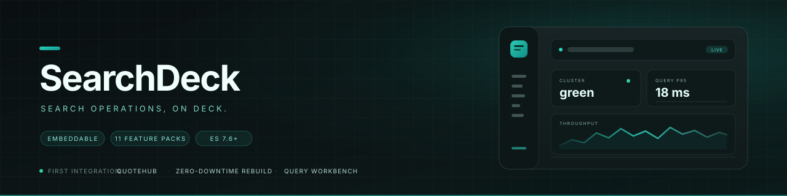
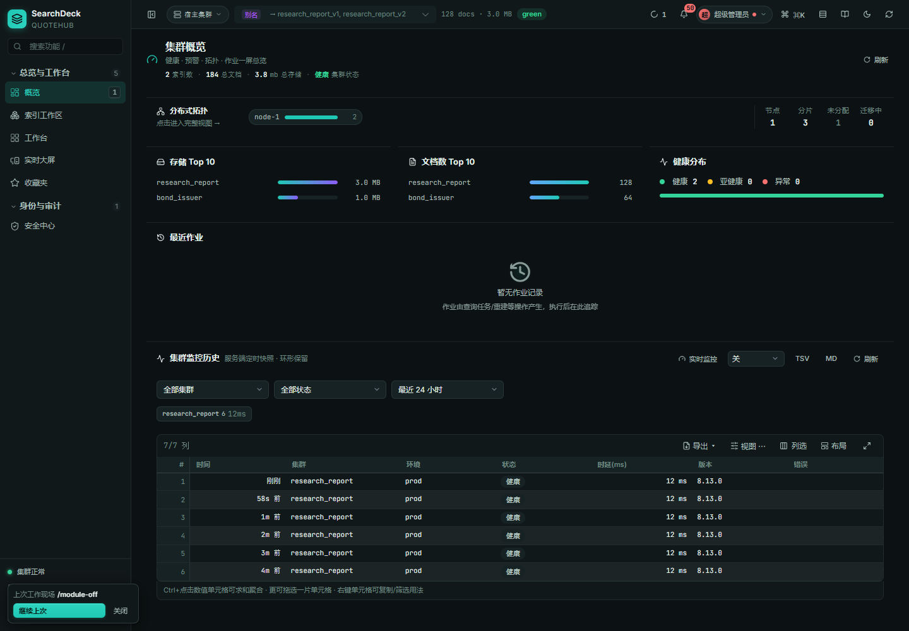
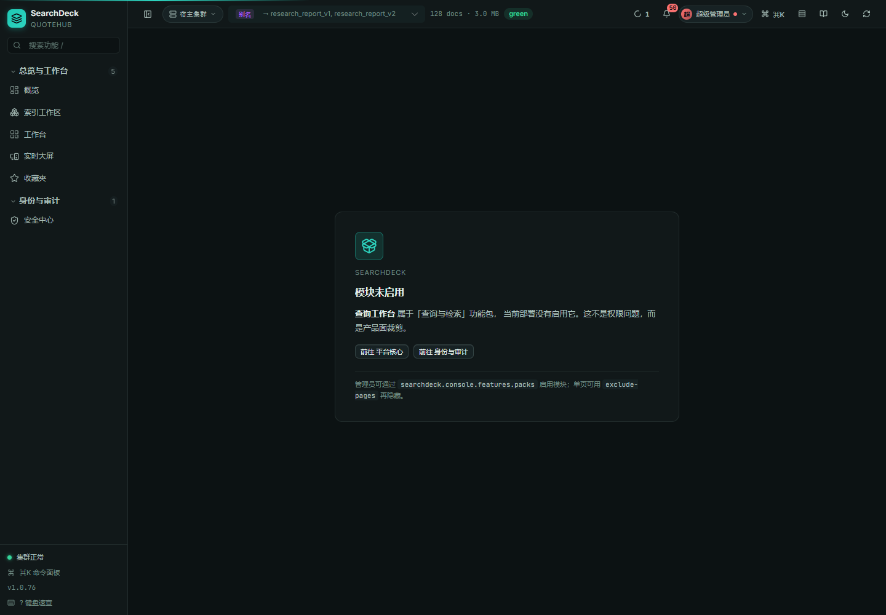
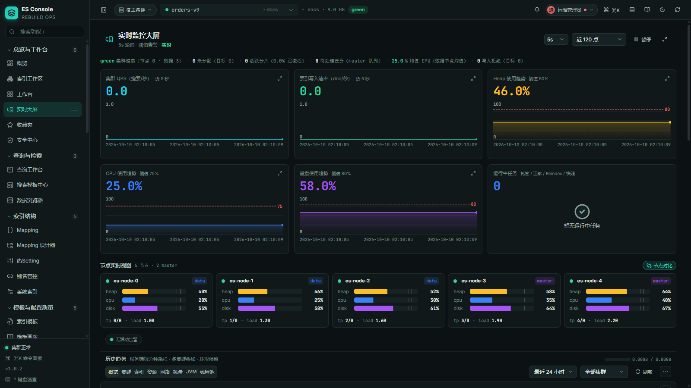
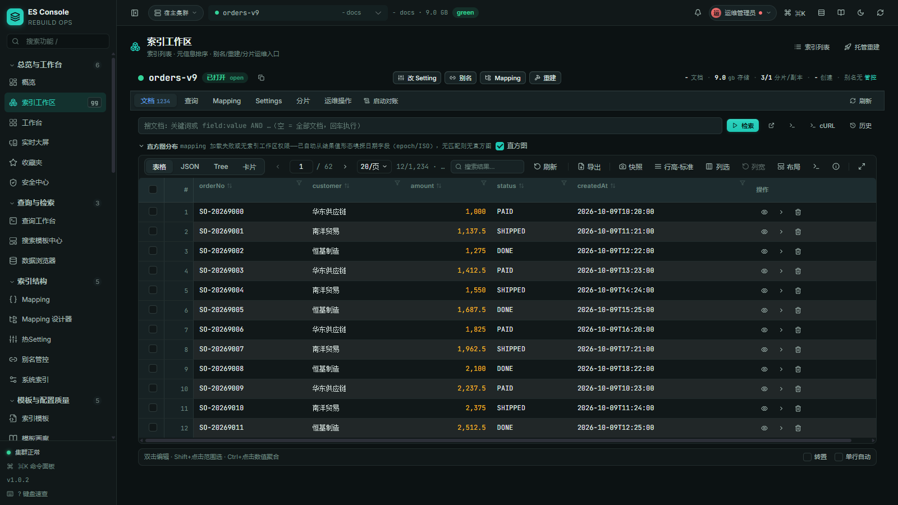
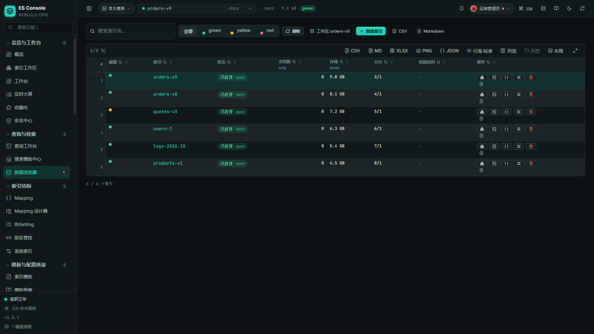
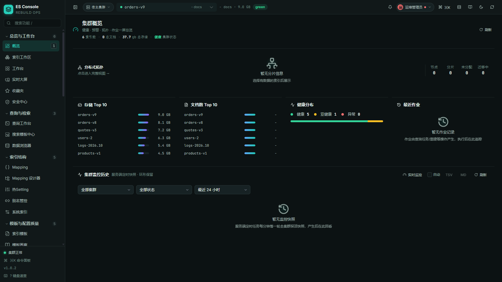
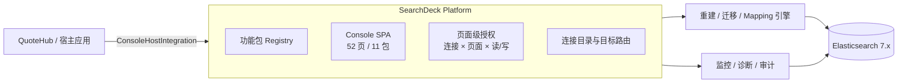

# 🧭 SearchDeck 搜索运维工作台

> **可嵌入的 Elasticsearch 运维平台。** 零停机重建、查询工作台、观测治理、数据浏览与宿主集成，
> 一套能力，三种交付。52 个页面收敛成 **11 个功能包**：默认全开，宿主按需裁剪。
> 首个接入方 **QuoteHub** 已在产线运行。

[](https://github.com/dengmeiluan/searchdeck/releases)
[](https://github.com/dengmeiluan/searchdeck/actions/workflows/ci.yml)
[](https://openjdk.java.net)
[](https://spring.io/projects/spring-boot)
[](https://www.elastic.co)
[](LICENSE)
[](#贡献)



**[快速开始](#-5-分钟接入)** · [English README](README_EN.md) · [功能包](#-功能包11-个模块按需上甲板) · [QuoteHub 接入](docs/integrations/quotehub.md) · [交互宪法](docs/design.md)

---

## 🛳️ 它是什么

SearchDeck 不是一个只解决「索引重建」的单点工具，而是一块可以嵌进任何搜索业务系统的
**运维驾驶舱**：

- **索引生命周期**：别名写索引翻转 + 服务端 `_reindex`，零停机重建；跨集群迁移、
  Reindex 预估、快照/SLM/ILM 与删除复活补偿。
- **查询工作台**：DSL / ES-SQL / Lucene / 沙盒 / PIT 分页 / 语法桥六模式，
  带请求体语义补全、值枚举、lint 与树⇄文本双向同步。
- **观测与治理**：节点 KPI、告警、慢请求、Top 索引、任务树、拓扑、体检报告、
  配置漂移与权限面。
- **宿主集成**：认证委托、连接目录、页面契约菜单、品牌与功能包裁剪；
  QuoteHub 是第一个接入方。

### 它不是什么

| 是 | 不是 |
|---|---|
| Elasticsearch 7.x 的运维 / 查询 / 治理工作台 | 通用 BI 或拖拽式大屏搭建器 |
| 可独立部署，也可作为 Spring Boot starter 嵌入宿主 | 必须依赖某一家的云服务或 SaaS |
| 宿主可以裁剪产品面、接管认证与连接目录 | 自带业务语义的行情 / 报价系统 |
| 页面级授权的控制台（连接 × 页面 × 读/写） | 用隐藏菜单代替服务端校验的「假权限」 |

---

## 🧩 为什么是 SearchDeck

1. **一个平台，两种形态**：Kibana 式 `java -jar` 独立部署，或嵌进宿主 Spring Boot 应用共享认证与路由。
2. **产品面可裁剪**：11 个功能包 + 单页排除，宿主只暴露自己需要的模块；深链访问未启用模块会落到
   可解释的「模块未启用」页，而不是空白或 404。
3. **宿主优先的 SPI**：`ConsoleAuthDelegate`、`ConnStore`、`ConsoleAuditContributor` 与
   `ConsoleHostIntegration` 分工明确；页面契约是前端导航、后端页面门、宿主菜单注册器三端唯一事实源。

---

## 📦 功能包：11 个模块，按需上甲板

默认全开。宿主在 `searchdeck.console.features.packs` 里列出需要的包即可收敛；
`exclude-pages` 可在包之上再隐藏单页。功能包是**部署选择**，不是权限——权限仍由
`grantedPages` 的页面级读/写键决定。

| Pack | 页面数 | 你在里面能做什么 |
|---|---:|---|
| `platform` | 5 | 概览、索引工作区、工作台、实时大屏、收藏夹 |
| `search` | 3 | 查询工作台（DSL/SQL/Lucene/沙盒/PIT/语法桥）、搜索模板、数据浏览器 |
| `index` | 5 | Mapping 与设计器、热 Setting、别名管控、系统索引 |
| `quality` | 5 | 索引模板、模板画廊、配置校验、配置漂移、优化向导 |
| `data` | 3 | Bulk 编辑、Update By Query、文档 Diff |
| `text` | 4 | 分词验证、分词实验室、同义词字典、Analysis 全景 |
| `relevance` | 6 | 打分解剖、排名侦探、Boost 调参、命中矩阵、查询 X 光、Profile 火焰图 |
| `lifecycle` | 8 | 托管重建、跨集群迁移、Reindex 高级/预估、快照、SLM、ILM、生命周期 |
| `observe` | 9 | 诊断、一键体检、拓扑、Watcher、任务/任务树、集群设置、插件、远程集群 |
| `security` | 1 | 安全中心：账号、权限面、操作审计 |
| `devtools` | 3 | REST 直连、Dev Tools 多标签、Painless 沙盒 |

> 页面契约 `META-INF/es-console-pages.json` 是唯一事实源：前端导航、后端页面级拦截、
> 宿主菜单注册器都从这里派生。功能包只改变「暴露面」，不改变 page key。

**QuoteHub 裁剪后的控制台**（演示数据）——品牌副标题跟随宿主，导航只剩 2 组 6 页：



**停用模块的可解释落地页**（演示数据）——深链访问未启用模块不再空白或 404：



---

## 🖥️ 控制台一览

**实时监控大屏** —— 节点 KPI、集群趋势、告警与慢请求一屏尽览：



**索引工作区** —— 索引列表 + 内嵌文档网格，筛选/列统计/快照/导出一体：



**数据浏览器** —— 索引目录与文档级 CRUD，CSV/Markdown/XLSX 多格式导出：



**集群概览** —— 健康/存储/文档分布与集群监控历史：



> 截图全部来自真实控制台；仓库不提供伪造的在线演示。启动方式见下方「三种交付形态」。

### 运维控制台能力

- **托管重建** —— 向导式零停机重建：选索引 → 审值 settings/mapping → 追平策略 → 确认预览 → 执行监控。
- **索引工作区** —— 索引列表 + 内嵌文档网格：筛选/列统计/快照/导出/直改。
- **查询工作台** —— DSL / ES-SQL / Lucene / 沙盒 / PIT 分页 / 语法桥六模式，智能补全与高亮。
- **数据浏览器** —— 文档 CRUD、列统计、CSV/Markdown/XLSX 多格式导出。
- **集群治理** —— 索引/别名/mapping/ILM/快照/任务树/设置漂移/健康报告。
- **权限审计** —— 页面级授权（连接 × 页面 × 读/写）+ 宿主审计贡献。
- **实时监控** —— 节点 KPI/告警/慢请求/Top 索引，多集群视角。

---

## 🚀 三种交付形态

### A. 独立部署（Kibana 式）

```bash
java -jar searchdeck-server.jar
```

内置 Web 服务器（默认端口 `5601`）与 ES 客户端栈，不依赖宿主应用。打开
`http://localhost:5601/searchdeck.html`，按 Setup 向导完成控制集群首连；
（2.0 多模块资产名；1.x 发布包仍为 `es-rebuild-standalone-*.jar`。）

首连档案持久在 `~/.es-console/`，重启即达。详见 [standalone/README.md](standalone/README.md)。

### B. 嵌入式 console 模块

把 `searchdeck-console` 加进宿主 Spring Boot 应用，控制台静态资源与 HTTP 端点自动注册；
认证可委托宿主（iframe 共享登录态）。适合与业务系统一体化交付。

### C. 宿主集成（QuoteHub 首个）

QuoteHub 已经通过认证委托、连接中心贡献、页面契约菜单与宿主审计贡献接入产线。
SearchDeck 在此基础上新增 **品牌 + 功能包** 声明：

```java
@Bean
public ConsoleHostIntegration searchDeckQuoteHubIntegration() {
    return new ConsoleHostIntegration() {
        public String id() { return "quotehub"; }
        public String displayName() { return "QuoteHub"; }
        public List<String> preferredPacks() {
            return Arrays.asList("platform", "search", "index", "data",
                    "lifecycle", "observe", "security", "devtools");
        }
    };
}
```

完整接入面、QA 期审计退场方式与验收清单：[docs/integrations/quotehub.md](docs/integrations/quotehub.md)。

---

## ⚡ 5 分钟接入

> **坐标迁移说明**：仓库正在从单 jar 的 `es-rebuild-spring-boot-starter` 迁移到多模块
> `searchdeck-*`（2.0 线）：`searchdeck-platform`（内核）、`searchdeck-console`（可嵌入控制台）、
> `searchdeck-server`（独立应用）、`searchdeck-quotehub`（首个宿主适配器）。
> 下面的平台配置已经可用；1.x 坐标在迁移期保留。

### 1. 引入依赖

```xml
<!-- SearchDeck 2.0：嵌入式控制台模块（传递 platform 内核） -->
<dependency>
    <groupId>io.github.dengmeiluan</groupId>
    <artifactId>searchdeck-console</artifactId>
    <version>2.0.0</version>
</dependency>

<!-- 1.x 兼容坐标（当前已发布版本） -->
<dependency>
    <groupId>io.github.dengmeiluan</groupId>
    <artifactId>es-rebuild-spring-boot-starter</artifactId>
    <version>1.0.76</version>
</dependency>
```

> **ES 栈由接入方自备（provided 契约）**：starter 不传递 ES 客户端栈。宿主需同时声明
> `spring-boot-starter-data-elasticsearch` 与 `elasticsearch-rest-high-level-client`。
> 启动期 `EsStackContractValidator` 比对真实类型签名（不比版本号），错配即拒绝启动并给出
> 两条可操作的修复路径。详见 [ES 栈契约 FAQ](docs/es-stack-contract.md)。

### 2. 声明实体与托管重建

```java
@Document(indexName = "bond_quote")
public class BondQuoteES {
    @Id
    private String id;

    @Field(type = FieldType.Keyword)
    private String bondCode;

    @Field(type = FieldType.Text, analyzer = "ik_max_word", searchAnalyzer = "ik_smart")
    private String shortName;
}
```

启动时自动把新增字段安全登记到既有索引（mapping auto-register）。需要改字段类型 /
analyzer / 建新物理索引时，走托管重建四步：

```
建新索引(新 mapping) → 服务端 _reindex 回填 → 别名原子翻转写索引 → 观察期 → 旧索引下线
```

全过程读写不停；重建窗口内被删除的文档在回填后自动补偿，不留幽灵数据。

### 3. 平台配置

```yaml
searchdeck:
  console:
    branding:
      product-name: SearchDeck          # 宿主可改成自己的产品名
      tagline: Search operations, on deck.
      integration-id: quotehub
      integration-name: QuoteHub
    features:
      packs: [platform, search, index, lifecycle, observe, devtools]
      exclude-pages: []                 # 再隐藏单页，例如 [security]
  elasticsearch:
    mode: console                       # rebuild-only：纯引擎；console：引擎 + 控制台
    console:
      store: sqlite                     # 作业+审计存哪：control-es / sqlite / jdbc
```

平台层 `searchdeck.console.*` 与引擎层 `searchdeck.elasticsearch.*` 分离：前者描述
「产品长什么样、暴露哪些模块」，后者描述重建/迁移/存储等运行参数。一代 `es.rebuild.*`
键仍作为别名可用（由环境后处理器透明桥接）。

### 4. HTTP 端点

映射自动对账入口由 `InternalEsIndexRebuildController` 暴露在 `/internal/es/index/` 前缀下：

| 端点 | 用途 |
|---|---|
| `POST /internal/es/index/rebuild` | 触发一次零停机重建 |
| `GET /internal/es/index/keys` | 枚举已注册的 `ManagedEsIndex` 键 |
| `GET /internal/es/index/desired-state.html` | 期望配置页：业务侧声明 mapping 期望，宿主确认后受控执行 |

### 5. 映射自动对账

启动期由 `MappingReconcile` 承担：`es.rebuild.mapping.auto-register=startup` 时新字段自动补入；
冲突按 `es.rebuild.mapping.conflict-policy` 处置（`fail` 拒绝启动 / `warn` 仅提交无冲突 additions）；
冲突修复建议返回 `USE_ADHOC_REBUILD` 走托管重建。详见[接入文档](docs/integration/README.md)。

---

## 🏗️ 架构



**分层**：平台内核（品牌/功能包/宿主 SPI）→ 控制台模块（查询/索引/观测/安全）→
引擎模块（重建/迁移/映射）。功能包在合约层显式声明，后端页面门仍按完整契约执法。

### 项目结构

```text
searchdeck/
├─ platform/                 searchdeck-platform：页面契约、功能包、品牌、宿主 SPI
├─ modules/console/          searchdeck-console：引擎 + 控制台 + 内嵌 UI 资源
├─ apps/server/              searchdeck-server：Kibana 式独立部署
├─ integrations/quotehub/    searchdeck-quotehub：首个宿主适配器
├─ ui/                       @searchdeck/ui：Vue 3 控制台源码
└─ examples/demo-host/       可运行宿主示例
```

引擎与 console 的包依赖目前存在环（auth ↔ multicluster ↔ xmigrate ↔ config），
因此 `engine/` 先作为 console 内的边界目录隔离，待接口反转后再独立成 artifact。

---

## 🎛️ 交互宪法

控制台的设计不是「能看就行」，而是一套可测试的约束：

1. **最短路径**：高频动作 ≤1 次点击直达；低频动作收进 ⋯ 菜单。
2. **位置恒定**：状态转换后同一动作仍在同一像素位置。
3. **状态不重置**：翻页/刷新/切模式后，筛选、滚动、草稿、焦点全部保留。
4. **多按钮合一**：互斥/成对动作合并为双态钮、分段控件或下拉聚合。
5. **弹层四要素**：白底 + 边框 + 阴影 + 圆角；Esc 关闭且焦点回触发器。

完整条款与交付序列见 [docs/design.md](docs/design.md)。

---

## ✅ 质量与验证

- **前端契约锁 + 真机行为链**：契约派生、DSL 往返、表格内核、权限门与快捷键盘都有源码/行为断言。
- **后端全量门禁**：Maven 测试覆盖认证、页面授权、重建状态机、映射对账、跨集群迁移与存储档。
- **真实浏览器验证**：Mock ES + 真实控制台，验证补全、lint、导航裁剪、深链停用页与权限矩阵。
- **反向对照**：非法契约、未知功能包、空页面授权等失败样本必须先红后绿，不靠「没报错」证明正确。

```bash
# 前端
cd console && npm ci
npm run typecheck          # vue-tsc 0
npm test                   # 分片全量

# 后端
./mvnw clean package       # 自动复用 console 构建产物
./mvnw test -Dconsole.build.skip=true
```

---

## 🗺️ 路线图

- [x] **阶段 1 · 平台化身份**：SearchDeck 品牌、合约功能包、运行时 UI 配置、
      宿主 `ConsoleHostIntegration` SPI、QuoteHub 接入文档、停用页与快捷键收敛。
- [ ] **阶段 2 · 坐标与包结构迁移**：Maven 坐标、Java 包、前端目录与组件命名；
      QuoteHub 同步升级并回归三账号矩阵。
- [ ] **阶段 3 · 开源发布**：GitHub 仓库更名、静态入口/事件/存储键迁移、
      发布资产与完整文档站。

---

## 🛠️ 从源码构建

```bash
git clone https://github.com/dengmeiluan/searchdeck.git
cd searchdeck

# 前端（Node 18+）
cd ui && npm ci && npm run build && cd ..

# 后端（JDK 8+，reactor 自动复用 ui 构建产物）
./mvnw clean package

# 测试
cd ui && npm test && cd ..
./mvnw test -Dconsole.build.skip=true
```

可运行示例：[examples/demo-host](examples/demo-host/) —— 一个 `@Document` 实体 +
`@SpringBootApplication`，即得全套运维控制台。

---

## 贡献

欢迎 Issue / PR。开始之前请读 [CONTRIBUTING.md](CONTRIBUTING.md) 与
[docs/design.md](docs/design.md)。涉及宿主集成时，优先通过 SPI 扩展，
不要在 starter 里硬编码业务字段。

## License

[Apache-2.0](LICENSE)
