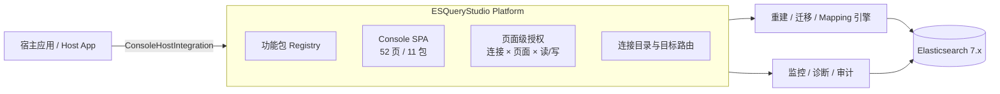

# ESQueryStudio · Elasticsearch 查询工作台

> **为 Spring Boot 而生的 Elasticsearch 查询工作台。** 六种查询模式共用同一个现场：
> DSL 构建器与原始编辑器双向同步、mapping / analyzer / 版本感知的补全与 lint、
> 打分树与 Profile 火焰图。嵌进宿主后共享登录态、路由和权限，52 个页面收敛成 11 个功能包。

[](https://github.com/dengmeiluan/esquerystudio/releases)
[](https://github.com/dengmeiluan/esquerystudio/actions/workflows/ci.yml)
[](https://openjdk.java.net)
[](https://spring.io/projects/spring-boot)
[](https://www.elastic.co)
[](LICENSE)
[](#贡献)
[](https://github.com/dengmeiluan/esquerystudio/actions/workflows/codeql.yml)
[](https://securityscorecards.dev/viewer/?uri=github.com/dengmeiluan/esquerystudio)


**[5 分钟接入](#-5-分钟接入)** · [English README](README_EN.md) · [查询工作台](docs/query-workbench.md) · [Chrome 扩展](#-chrome-扩展原生-vue-控制台双模式同源) · [功能包](#-功能包11-个模块按需上甲板) · [宿主集成](docs/integration/README.md) · [架构](docs/architecture.md)

---

## 🎯 核心：一块真正懂 Elasticsearch 的查询工作台

ESQueryStudio 的主角不是又一个索引管理表格，而是**查询工作台**。它把 Elasticsearch 查询从「记住 DSL 语法、复制 JSON、再回浏览器看结果」变成一块连续的编辑面：左边是条件树，右边是原始请求体，下面是结果、直方图和耗时；切到 SQL、Lucene 或 PIT，现场不丢。

### 六个模式，一个现场

| 模式 | 你得到什么 |
|---|---|
| **DSL 构建器** | 条件树 + 原始编辑器双向同步；40+ 子句按字段类型出现，稀有子句有专门入口，不认识的子句也能退回原文编辑 |
| **ES-SQL** | `_sql` 查询、`cursor` 深分页、字段体检、结果表/JSON/Tree/卡片视图，SQL 与 DSL 一键互转 |
| **Lucene** | Lucene 语法直查，保留原始高亮与命中行，可带去构建器继续精修 |
| **查询沙盒** | 自由写 DSL、看原始响应、对比 `_source` 与高亮，适合验证一个假设 |
| **PIT 深分页** | 基于 Point-in-Time 的稳定翻页，游标断了能解释、能续拉，不在 10k 窗口前停住 |
| **语法桥** | SQL 与 DSL 互相翻译时保留语义差异提示，不把「翻译成功」当成「语义等价」 |

### 不是「补全几个关键字」，而是理解你的索引

- **mapping 感知**：字段类型、`text` / `keyword` 子字段、嵌套对象、日期格式都来自当前索引的实时 mapping；补全和 lint 不会给你一个 ES 不接受的建议。
- **analysis 感知**：分词器、normalizer、同义词与 `analysis` 设置参与候选；字段值枚举直接来自索引，不再靠猜。
- **版本感知**：按当前集群版本标注 `minVer`，7.x 与 8.x 的差异在入口处就说清楚，不让用户把版本不兼容当成查询写错。
- **双向同步**：条件树改完，JSON 立即更新；JSON 改完，条件树按语义重建。只改一边、另一边静默过期的情况不会发生。
- **lint 是语义检查**：字段不存在、类型不可排序、`text` 未走 `.keyword`、日期格式不匹配、聚合/排序冲突，都在执行前给出可操作的修复建议。
- **现场可回放**：跨模式查询历史、收藏、草稿、分享深链共用一套现场；切模式、翻页、刷新不会把写到一半的查询清空。

### 从「为什么这条命中」到「为什么慢」

查询工作台不是一个孤立的输入框。它和相关性实验室共用同一个查询现场：

- **打分解剖**：把每个命中文档的 BM25 因子树展开到 `tf` / `idf` / `boost` / `norm`，看清是哪一项在推高分数。
- **排名侦探**：对单文档追问「为什么是它」，对比不同查询下同一文档的得分路径。
- **查询 X 光**：逐子句查看词项、命中数和被分析器改写后的实际查询。
- **子句命中矩阵**：哪条子句命中了哪些文档，一屏对齐，专门抓「写了但没起作用」的条件。
- **Profile 火焰图**：把 `profile=true` 的查询/采集器耗时展开成火焰图，定位慢在 rewrite、build_scorer 还是 next_doc。

> 这些页面共享 `?idx=` 与查询现场，不是六个互不相干的工具页。截图全部来自真实控制台（Mock ES 数据），仓库不提供伪造的在线演示。

---

## 🛳️ 它是什么

ESQueryStudio 是一个**可嵌入的 Elasticsearch 查询与运维平台**，不是一个只解决「索引重建」的单点工具：

- **查询工作台**：DSL / ES-SQL / Lucene / 沙盒 / PIT / 语法桥六模式，mapping 感知补全、lint、树⇄文本双向同步、历史与收藏。
- **索引生命周期**：别名写索引翻转 + 服务端 `_reindex`，零停机重建；跨集群迁移、Reindex 预估、快照 / SLM / ILM 与删除复活补偿。
- **观测与治理**：节点 KPI、告警、慢请求、Top 索引、任务树、拓扑、体检报告、配置漂移与权限面。
- **宿主集成**：认证委托、连接目录、页面契约菜单、品牌与功能包裁剪；通过 `ConsoleHostIntegration` SPI 适配任意 Spring Boot 宿主，不绑定具体业务系统。

### 适合谁

| 你在做什么 | ESQueryStudio 给你的 |
|---|---|
| Java / Spring Boot 团队把 ES 作为主搜索或日志存储 | 不用再部署一套 Kibana；控制台随应用发布，登录态、路由、权限和菜单都留在宿主 |
| 搜索质量 / 相关性团队 | 构建器、打分树、排名侦探、X 光、命中矩阵、Profile 火焰图在同一现场 |
| 平台团队要交付「可查、可改、可治理」的 ES 能力 | 页面级权限、功能包裁剪、连接目录、审计贡献、独立 jar 或嵌入式两种形态 |
| 正在做索引重建 / 迁移 / 容量治理 | 托管重建、跨集群迁移、Reindex 预估、快照与生命周期成套出现 |

### 它不是什么

| 是 | 不是 |
|---|---|
| Elasticsearch 7.x 的查询 / 运维 / 治理工作台 | 通用 BI 或拖拽式大屏搭建器 |
| 可独立部署，也可作为 Spring Boot starter 嵌入宿主 | 必须依赖某一家的云服务或 SaaS |
| 宿主可以裁剪产品面、接管认证与连接目录 | 自带业务语义的行情 / 报价系统 |
| 页面级授权的控制台（连接 × 页面 × 读/写） | 用隐藏菜单代替服务端校验的「假权限」 |
| ES 客户端栈由宿主提供的 `provided` 契约 | 把一整套 ES 客户端版本强塞进宿主 classpath |

---

## 🧩 为什么是 ESQueryStudio

1. **查询工作台优先**：先把「写查询、看结果、解释分数、定位慢点」做成一条连续动线，再向外长成索引与运维能力；不是把一堆管理页拼在一起。
2. **真正懂 ES 的语义层**：mapping、analysis、版本、字段角色、可排序性都进入补全、lint、值枚举与执行前检查，减少「语法对但语义错」。
3. **一个平台，两种形态**：Kibana 式 `java -jar` 独立部署，或嵌进宿主 Spring Boot 应用共享认证与路由。
4. **产品面可裁剪**：11 个功能包 + 单页排除，宿主只暴露自己需要的模块；深链访问未启用模块会落到可解释的「模块未启用」页，而不是空白或 404。
5. **宿主优先的 SPI**：`ConsoleAuthDelegate`、`ConnStore`、`ConsoleAuditContributor` 与 `ConsoleHostIntegration` 分工明确；页面契约是前端导航、后端页面门、宿主菜单注册器三端唯一事实源。

---

## 📦 功能包：11 个模块，按需上甲板

默认全开。宿主在 `esquerystudio.console.features.packs` 里列出需要的包即可收敛；
`exclude-pages` 可在包之上再隐藏单页。功能包是**部署选择**，不是权限——权限仍由
`grantedPages` 的页面级读/写键决定。

| Pack | 页面数 | 你在里面能做什么 |
|---|---:|---|
| `platform` | 5 | 概览、索引工作区、工作台、实时大屏、收藏夹 |
| `search` | 3 | 查询工作台（DSL/SQL/Lucene/沙盒/PIT/语法桥）、搜索模板、数据浏览器 |
| `index` | 5 | Mapping 与设计器、热 Setting、别名管控、系统索引 |
| `quality` | 5 | 索引模板、模板画廊、配置校验、配置漂移、优化向导 |
| `data` | 3 | Bulk 编辑、Update By Query、文档 Diff |
| `text` | 4 | 分词验证、分词实验室、同义词字典、Analysis 全景 |
| `relevance` | 6 | 打分解剖、排名侦探、Boost 调参、命中矩阵、查询 X 光、Profile 火焰图 |
| `lifecycle` | 8 | 托管重建、跨集群迁移、Reindex 高级/预估、快照、SLM、ILM、生命周期 |
| `observe` | 9 | 诊断、一键体检、拓扑、Watcher、任务/任务树、集群设置、插件、远程集群 |
| `security` | 1 | 安全中心：账号、权限面、操作审计 |
| `devtools` | 3 | REST 直连、Dev Tools 多标签、Painless 沙盒 |

> 页面契约 `META-INF/esquerystudio-pages.json` 是唯一事实源：前端导航、后端页面级拦截、
> 宿主菜单注册器都从这里派生。功能包只改变「暴露面」，不改变 page key。

**页面地图**（13 个分组 / 52 页，宿主可按分组或单页裁剪）：

| 分组 | 页面 | 代表能力 |
|---|---:|---|
| `core` | 5 | 集群总览、索引工作区、Dev 工作台、实时大屏、收藏夹 |
| `search` | 3 | 六模式查询工作台、搜索模板、数据浏览器 |
| `index` | 5 | Mapping 与设计器、热 Setting、别名管控、系统索引 |
| `quality` | 5 | 索引模板、模板画廊、配置校验、配置漂移、优化向导 |
| `data` | 3 | Bulk 编辑、Update By Query、文档 Diff |
| `text` | 4 | 分词验证、分词实验室、同义词字典、Analysis 全景 |
| `rank` | 6 | 打分解剖、排名侦探、Boost 调参、命中矩阵、查询 X 光、Profile 火焰图 |
| `rebuild` | 4 | 托管重建、跨集群迁移、Reindex 高级与预估 |
| `protect` | 4 | 快照、SLM、ILM、生命周期 |
| `health` | 4 | 诊断、一键体检、拓扑、Watcher |
| `cluster` | 5 | 任务/任务树、集群设置、插件、远程集群 |
| `security` | 1 | 安全中心：账号、权限面、操作审计 |
| `devx` | 3 | REST 直连、Dev Tools 多标签、Painless 沙盒 |

---

## 🖥️ 控制台一览

**查询工作台** —— 条件树、原始 DSL、直方图与结果表在同一屏；mapping 感知补全和 lint 随输入更新：


**打分解剖** —— 每个命中文档的 BM25 因子树，`tf` / `idf` / `boost` / `norm` 逐层展开：


**SQL 控制台** —— `_sql` 查询、游标深分页、字段体检、结果多视图与 DSL 互转：


**集群概览** —— 健康、存储、文档分布与集群监控历史：


### 运维控制台能力

- **托管重建** —— 向导式零停机重建：选索引 → 审值 settings/mapping → 追平策略 → 确认预览 → 执行监控。
- **索引工作区** —— 索引列表 + 内嵌文档网格：筛选 / 列统计 / 快照 / 导出 / 直改。
- **查询工作台** —— DSL / ES-SQL / Lucene / 沙盒 / PIT / 语法桥六模式，智能补全与高亮。
- **数据浏览器** —— 文档 CRUD、列统计、CSV / Markdown / XLSX 多格式导出。
- **集群治理** —— 索引 / 别名 / mapping / ILM / 快照 / 任务树 / 设置漂移 / 健康报告。
- **权限审计** —— 页面级授权（连接 × 页面 × 读/写）+ 宿主审计贡献。
- **实时监控** —— 节点 KPI / 告警 / 慢请求 / Top 索引，多集群视角。

---

## 🚀 三种交付形态

### A. 独立部署（Kibana 式）

```bash
java -jar esquerystudio-server.jar
```

内置 Web 服务器（默认端口 `5601`）与 ES 客户端栈，不依赖宿主应用。打开
`http://localhost:5601/esquerystudio.html`，按 Setup 向导完成控制集群首连。

首连档案持久在 `~/.esquerystudio/`，重启即达。详见 [apps/server/README.md](apps/server/README.md)。

### B. 嵌入式 console 模块

把 `esquerystudio-console` 加进宿主 Spring Boot 应用，控制台静态资源与 HTTP 端点自动注册；
认证可委托宿主（iframe 共享登录态）。适合与业务系统一体化交付。

### C. 宿主集成（SPI 驱动，不绑定具体宿主）

ESQueryStudio 不要求宿主改造成某一种业务形态。实现 `ConsoleHostIntegration` 声明品牌与
默认功能包，再按需接入认证委托、连接目录与审计贡献即可：

```java
@Bean
public ConsoleHostIntegration esQueryStudioHostIntegration() {
    return new ConsoleHostIntegration() {
        public String id() { return "acme"; }
        public String displayName() { return "Acme Search"; }
        public List<String> preferredPacks() {
            return Arrays.asList("platform", "search", "index", "data",
                    "lifecycle", "observe", "security", "devtools");
        }
    };
}
```

宿主自定义面全部是接口：`ConsoleAuthDelegate`（认证）、`ConnStore`（连接目录）、
`ConsoleAuditContributor`（审计）、`ConsolePageCatalog`（菜单）。完整接入面与验收清单：
[docs/integration/README.md](docs/integration/README.md)。

**按场景选择**：

| 你的场景 | 选用 | 额外工作 |
|---|---|---|
| 独立运维一个或多个 ES 集群 | `esquerystudio-server` 独立 jar | 无，打开 Setup 向导即可 |
| 已有 Spring Boot 业务应用 | `esquerystudio-console` 嵌入式 | 声明 `@Document` 实体；可选认证委托 |
| 与宿主账号、菜单、审计一体化 | `esquerystudio-console` + 宿主 SPI | 实现 `ConsoleHostIntegration` 与 `ConsoleAuthDelegate` |
| 只要重建 / 迁移引擎 | `esquerystudio-console`，`mode=rebuild-only` | 不暴露控制台页面与静态资源 |

---

## 🧩 Chrome 扩展：原生 Vue 控制台，双模式同源

同一套 Vue 控制台源码，服务端模式（Spring Boot 提供 `/internal/es/index`）与浏览器模式（插件内直连 ES）只切换 transport，不再维护第二套 UI。插件主界面就是完整 52 页 Vue 控制台（browser 构建），首次打开填写 ES 地址后，页面/路由/组件/样式与服务端模式完全同源。


- **服务端模式**：同一套 Vue 源码由 Spring Boot server 提供，经 `/internal/es/index` 后端适配；原有 52 页、11 功能包、宿主 SPI 全部保留。
- **浏览器模式**：插件内运行同一套 Vue 源码的 `browser` 构建，`api.ts` 底层 transport 切换为浏览器直连 ES；首次连接在原生连接层填写地址，凭据只存本机。
- **直连工具页**：右键扩展图标打开轻量调试页（DSL/Lucene/ES-SQL/PIT、Explain、REST、Reindex、监控），不冒充完整控制台。
- **覆盖**：索引/Mapping/Setting/别名/模板、快照/ILM/SLM/Watcher、任务/节点/REST/SQL/PIT/Reindex/Bulk/托管重建、跨集群迁移（客户端 scroll+bulk）、配置校验（L1+L2 dry-run）均可用；监控历史/告警、操作审计、重建/迁移作业落在本机 IndexedDB/localStorage，页面仍走同一套 API 契约。
- **边界**：系统索引、配置漂移继续依赖服务端控制面，进入时显示明确说明；本机监控每分钟采样（控制台打开时由页面采样，关闭后由扩展 service worker 继续），只保存在本机，不伪造离线历史；账号由 Elasticsearch 自身认证。
- **安装**：打开 `chrome://extensions` → 开启开发者模式 → **加载已解压的扩展程序** → 选择包含 `manifest.json` 的文件夹（源码为 `extensions/chrome`；Release zip 请先解压，不要直接选 zip）。

细节与安全说明见 [extensions/chrome/README.md](extensions/chrome/README.md)。

---

## ⚡ 5 分钟接入

### 1. 引入依赖

```xml
<!-- 嵌入式控制台模块（传递 esquerystudio-platform 内核） -->
<dependency>
    <groupId>io.github.dengmeiluan</groupId>
    <artifactId>esquerystudio-console</artifactId>
    <version>1.0.0</version>
</dependency>
```

> **ES 栈由接入方自备（provided 契约）**：starter 不传递 ES 客户端栈。宿主需同时声明
> `spring-boot-starter-data-elasticsearch` 与 `elasticsearch-rest-high-level-client`。
> 启动期 `EsStackContractValidator` 比对真实类型签名（不比版本号），错配即拒绝启动并给出
> 两条可操作的修复路径。详见 [ES 栈契约 FAQ](docs/es-stack-contract.md)。

### 2. 声明实体与托管重建

```java
@Document(indexName = "bond_quote")
public class BondQuoteES {
    @Id
    private String id;

    @Field(type = FieldType.Keyword)
    private String bondCode;

    @Field(type = FieldType.Text, analyzer = "ik_max_word", searchAnalyzer = "ik_smart")
    private String shortName;
}
```

启动时自动把新增字段安全登记到既有索引（mapping auto-register）。需要改字段类型 /
analyzer / 建新物理索引时，走托管重建四步：

```text
建新索引(新 mapping) → 服务端 _reindex 回填 → 别名原子翻转写索引 → 观察期 → 旧索引下线
```

全过程读写不停；重建窗口内被删除的文档在回填后自动补偿，不留幽灵数据。

### 3. 平台配置

```yaml
esquerystudio:
  console:
    branding:
      product-name: ESQueryStudio          # 宿主可改成自己的产品名
      tagline: 为 Spring Boot 而生的 Elasticsearch 查询工作台
      integration-id: acme
      integration-name: Acme Search
    features:
      packs: [platform, search, index, lifecycle, observe, devtools]
      exclude-pages: []                 # 再隐藏单页，例如 [security]
  elasticsearch:
    mode: console                       # rebuild-only：纯引擎；console：引擎 + 控制台
    console:
      store: sqlite                     # 作业+审计存哪：control-es / sqlite / jdbc
```

平台层 `esquerystudio.console.*` 与引擎层 `esquerystudio.elasticsearch.*` 分离：前者描述
「产品长什么样、暴露哪些模块」，后者描述重建/迁移/存储等运行参数。

### 4. HTTP 端点

映射自动对账入口由 `InternalEsIndexRebuildController` 暴露在 `/internal/es/index/` 前缀下：

| 端点 | 用途 |
|---|---|
| `POST /internal/es/index/rebuild` | 触发一次零停机重建 |
| `GET /internal/es/index/keys` | 枚举已注册的 `ManagedEsIndex` 键 |
| `GET /internal/es/index/desired-state.html` | 期望配置页：业务侧声明 mapping 期望，宿主确认后受控执行 |

### 5. 映射自动对账

启动期由 `MappingReconcile` 承担：`esquerystudio.elasticsearch.mapping.auto-register=startup` 时新字段自动补入；
冲突按 `esquerystudio.elasticsearch.mapping.conflict-policy` 处置（`fail` 拒绝启动 / `warn` 仅提交无冲突 additions）；
冲突修复建议返回 `USE_ADHOC_REBUILD` 走托管重建。详见[接入文档](docs/integration/README.md)。

---

## 🏗️ 架构



**分层**：平台内核（品牌/功能包/宿主 SPI）→ 控制台模块（查询/索引/观测/安全）→
引擎模块（重建/迁移/映射）。功能包在合约层显式声明，后端页面门仍按完整契约执法。

### 项目结构

```text
esquerystudio/
├─ platform/                 esquerystudio-platform：页面契约、功能包、品牌、宿主 SPI
├─ modules/console/          esquerystudio-console：引擎 + 控制台 + 内嵌 UI 资源
├─ apps/server/              esquerystudio-server：Kibana 式独立部署
├─ docs/                     架构、接入与设计文档
├─ ui/                       @esquerystudio/ui：Vue 3 控制台源码
├─ extensions/chrome/       MV3 Chrome 扩展：前端直连查询工作台
└─ examples/demo-host/       可运行宿主示例
```

引擎与 console 的包依赖目前存在环（auth ↔ multicluster ↔ xmigrate ↔ config），
因此 `engine/` 先作为 console 内的边界目录隔离，待接口反转后再独立成 artifact。

### 兼容矩阵

| 维度 | 支持范围 |
|---|---|
| JDK | 8+（独立 jar 与嵌入式一致） |
| Spring Boot | 2.3.x 基线；宿主 2.7.x 已验证 |
| Elasticsearch | 7.x（7.6+ 推荐；内置 6.7 日期兼容转换器） |
| 操作系统 | Linux / macOS / Windows，纯 JVM 运行 |
| 部署形态 | 独立 jar、嵌入式模块、宿主 SPI 集成、`rebuild-only` 引擎 |
| 浏览器 | 现代 Chromium / Firefox / Safari，支持 iframe 嵌入与主题跟随 |

---

## 🎛️ 交互宪法

控制台的设计不是「能看就行」，而是一套可测试的约束：

1. **最短路径**：高频动作 ≤1 次点击直达；低频动作收进 ⋯ 菜单。
2. **位置恒定**：状态转换后同一动作仍在同一像素位置。
3. **状态不重置**：翻页/刷新/切模式后，筛选、滚动、草稿、焦点全部保留。
4. **多按钮合一**：互斥/成对动作合并为双态钮、分段控件或下拉聚合。
5. **弹层四要素**：白底 + 边框 + 阴影 + 圆角；Esc 关闭且焦点回触发器。
6. **第二通道等价**：表格/列表/卡片行的右键与菜单键（Shift+F10）打开同一菜单；行与可点击片段可聚焦，Enter/Space 等价于点击；菜单焦点入首项，Home/End 跳首末，Esc 回触发行。

完整条款与交付序列见 [docs/design.md](docs/design.md)。

---

## ✅ 质量与验证

- **前端契约锁 + 真机行为链**：契约派生、DSL 往返、表格内核、权限门、快捷键盘与右键/菜单键第二通道都有源码/行为断言；右键面键盘入口另有目录普查守卫，新增面漏补即红。
- **后端全量门禁**：Maven 测试覆盖认证、页面授权、重建状态机、映射对账、跨集群迁移与存储档。
- **真实浏览器验证**：Mock ES + 真实控制台，验证补全、lint、导航裁剪、深链停用页与权限矩阵。
- **反向对照**：非法契约、未知功能包、空页面授权等失败样本必须先红后绿，不靠「没报错」证明正确。
- **可复现发布**：固定 `project.build.outputTimestamp`；release profile 产出 sources/javadoc/SBOM；
  同一源码重复构建的 `platform` / `console` / `server` jar SHA-256 必须一致。
- **供应链与安全自动化**：CodeQL、OpenSSF Scorecard、Dependency Review、Dependabot 与 tag 驱动的
  Release workflow（校验版本、生成校验和与 provenance attestation）。

```bash
# 前端
cd ui && npm ci
npm run typecheck          # vue-tsc 0
npm test                   # 分片全量

# 后端
./mvnw clean package       # 自动复用 ui 构建产物
./mvnw test -Dconsole.build.skip=true
```

---

## 🗺️ 路线图

- [x] **阶段 1 · 查询工作台成型**：六模式共用现场、mapping 感知补全与 lint、树⇄文本双向同步、相关性实验室。
- [x] **阶段 2 · 平台化与多模块**：`platform` / `console` / `server` 三模块拆分，页面契约、功能包与宿主 SPI。
- [x] **阶段 3 · ESQueryStudio 1.0**：品牌与坐标统一、双语 README、示例宿主、接入文档与可复现发布。
- [ ] **阶段 4 · 引擎独立**：解除 `auth ↔ multicluster ↔ xmigrate ↔ config` 依赖环，把重建/迁移引擎拆成独立 artifact。
- [ ] **阶段 5 · 生态与成本**：版本化页面契约、插件清单、更多宿主模板与一键接入脚手架。

---

## 🛠️ 从源码构建

```bash
git clone https://github.com/dengmeiluan/esquerystudio.git
cd esquerystudio

# 前端（Node 18+）
cd ui && npm ci && npm run build && cd ..

# 后端（JDK 8+，reactor 自动复用 ui 构建产物）
./mvnw clean package

# 测试
cd ui && npm test && cd ..
./mvnw test -Dconsole.build.skip=true
```

可运行示例：[examples/demo-host](examples/demo-host/) —— 一个 `@Document` 实体 +
`@SpringBootApplication`，即得全套查询与运维控制台。

---

## 贡献

欢迎 Issue / PR。开始之前请读 [贡献指南](CONTRIBUTING.md)、[架构说明](docs/architecture.md)、
[文档索引](docs/README.md) 与 [设计宪法](docs/design.md)。参与即表示遵守
[行为准则](CODE_OF_CONDUCT.md)；决策与发布流程见 [治理](GOVERNANCE.md)，提问渠道见
[支持](SUPPORT.md)。涉及宿主集成时，优先通过 SPI 扩展，不要在平台里硬编码业务字段。


## License

[Apache-2.0](LICENSE)
