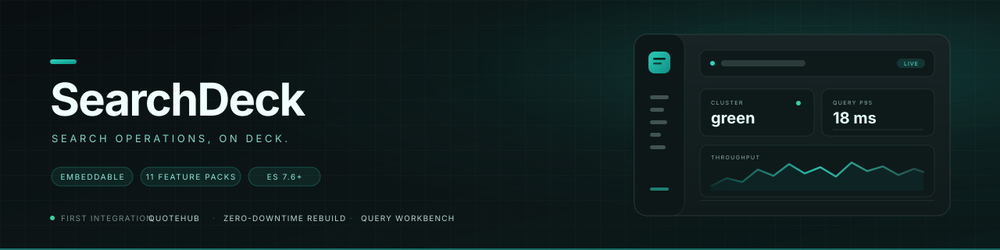
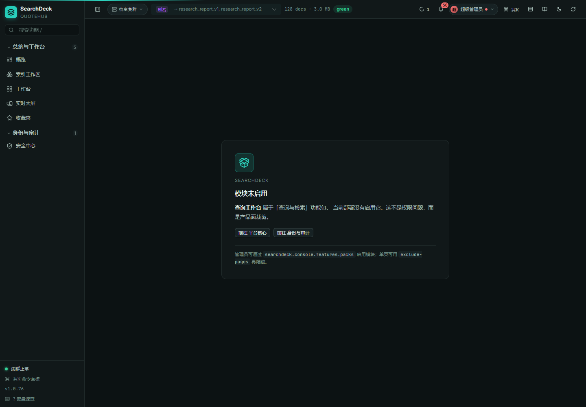
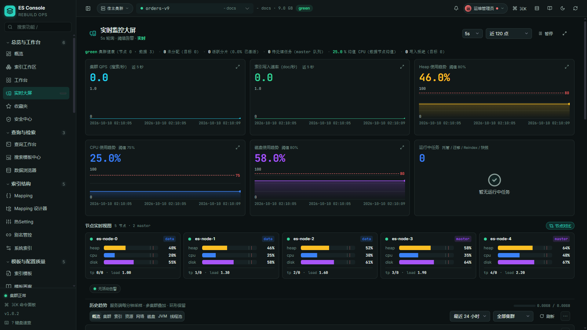
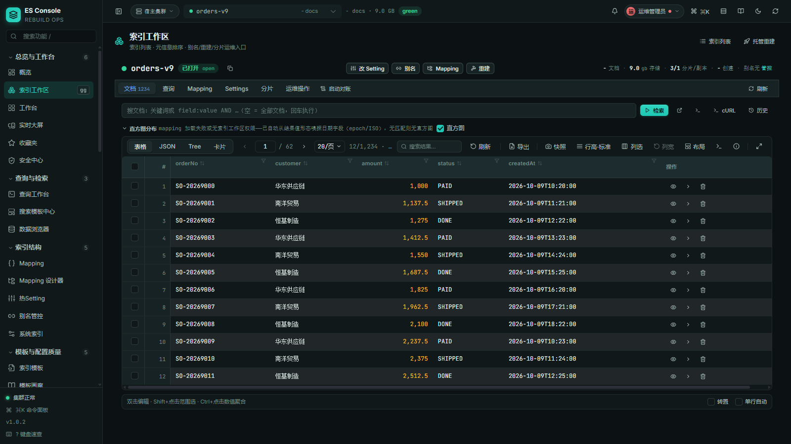
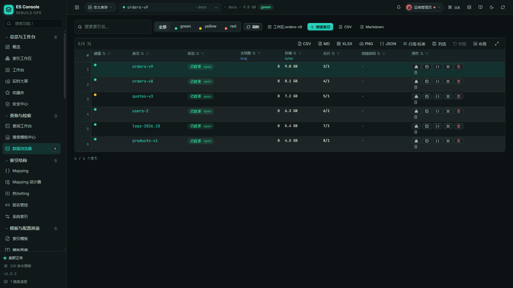
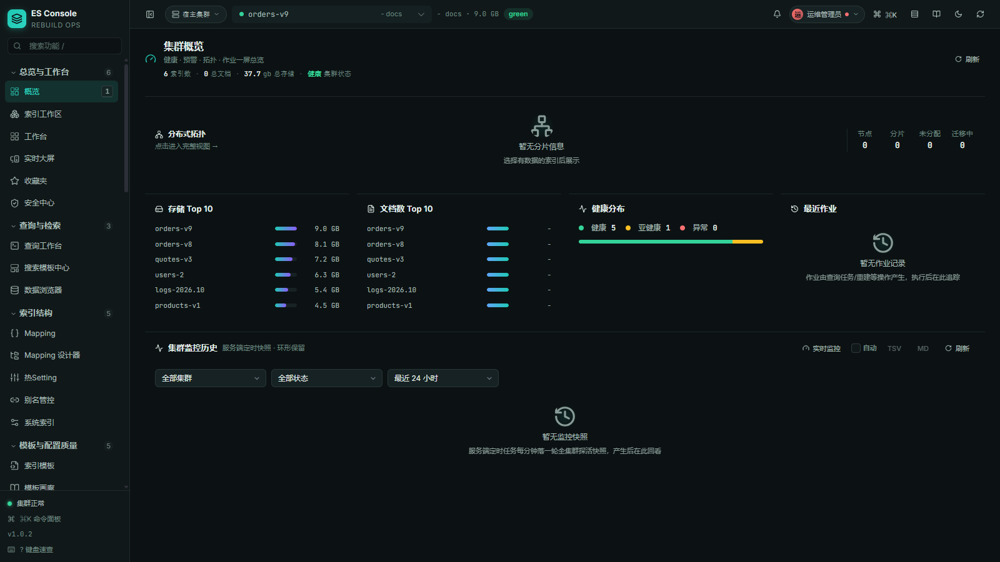
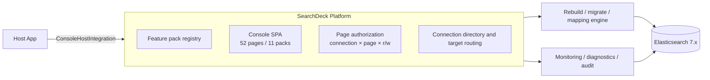

# 🧭 SearchDeck

> **The embeddable operations platform for Elasticsearch.** Zero-downtime index rebuilds,
> a query workbench, observability, data browsing, and host integration — one capability set,
> three delivery modes. 52 pages, **11 feature packs**: all on by default, trimmed by the host.
> Validated in a real host production environment.

[](https://github.com/dengmeiluan/searchdeck/releases)
[](https://github.com/dengmeiluan/searchdeck/actions/workflows/ci.yml)
[](https://openjdk.java.net)
[](https://spring.io/projects/spring-boot)
[](https://www.elastic.co)
[](LICENSE)



**[Quick start](#-five-minute-integration)** · [中文 README](README.md) · [Feature packs](#-feature-packs) · [Host integration](docs/integration/README.md) · [Design constitution](docs/design.md)

---

## 🛳️ What it is

SearchDeck is not a single-purpose index-rebuild tool. It is an **operations deck** that can be
embedded into any search-backed application:

- **Index lifecycle** — alias write-index flip + server-side `_reindex` for zero-downtime rebuilds;
  cross-cluster migration, reindex estimation, snapshots/SLM/ILM, and delete-resurrection compensation.
- **Query workbench** — DSL / ES-SQL / Lucene / sandbox / PIT pagination / syntax bridge,
  with request-body semantic completion, value enums, lint, and tree ⇄ text round-trip.
- **Observability and governance** — node KPIs, alerts, slow requests, top indices, task trees,
  topology, health reports, config drift, and permission surfaces.
- **Host integration** — authentication delegation, connection directory, page-contract menus,
  branding and feature-pack selection through the `ConsoleHostIntegration` SPI, with no coupling
  to a specific business system.

### What it is not

| It is | It is not |
|---|---|
| An Elasticsearch 7.x ops / query / governance workbench | A general-purpose BI or drag-and-drop dashboard builder |
| Deployable standalone or embeddable as a Spring Boot starter | Tied to a specific cloud or SaaS |
| A console whose product surface and auth can be owned by the host | A business system with built-in domain semantics |
| Page-level authorization (connection × page × read/write) | "Fake permissions" based on hidden menus |

---

## 🧩 Why SearchDeck

1. **One platform, two shapes** — Kibana-style `java -jar` standalone, or embedded into a host
   Spring Boot app sharing its auth and routing.
2. **A trimmable product surface** — 11 feature packs plus per-page exclusion. Deep links to a
   disabled module land on an explanatory "module not enabled" page, never a blank screen or 404.
3. **Host-first SPIs** — `ConsoleAuthDelegate`, `ConnStore`, `ConsoleAuditContributor`, and
   `ConsoleHostIntegration` have clear boundaries. The page contract is the single source of truth
   for frontend navigation, backend page gates, and host menu provisioning.

---

## 📦 Feature packs

All packs are enabled by default. A host lists only what it needs in
`searchdeck.console.features.packs`; `exclude-pages` hides individual pages on top of that.
Feature packs are **deployment choices, not permissions** — authorization remains the page-level
read/write keys in `grantedPages`.

| Pack | Pages | What you get |
|---|---:|---|
| `platform` | 5 | Overview, index workspace, workbench, live dashboard, favorites |
| `search` | 3 | Query workbench (DSL/SQL/Lucene/sandbox/PIT/bridge), search templates, data browser |
| `index` | 5 | Mapping + designer, hot settings, aliases, system indices |
| `quality` | 5 | Index templates, template gallery, config validator, config drift, optimizer |
| `data` | 3 | Bulk editor, Update By Query, document diff |
| `text` | 4 | Analyze, analyzer lab, synonyms, analysis panorama |
| `relevance` | 6 | Score explain, rank detective, boost tuner, match matrix, query X-ray, profile flame graph |
| `lifecycle` | 8 | Managed rebuild, cross-cluster migration, reindex advanced/estimate, snapshots, SLM, ILM |
| `observe` | 9 | Diagnostics, health report, topology, Watcher, tasks/task tree, cluster settings, plugins, remote clusters |
| `security` | 1 | Security center: accounts, permission surface, ops audit |
| `devtools` | 3 | REST passthrough, Dev Tools tabs, Painless sandbox |

> `META-INF/searchdeck-pages.json` is the single source of truth. Feature packs change exposure,
> never page keys.

**Page map** (13 groups / 52 pages; trim by group or by page):

| Group | Pages | Highlights |
|---|---:|---|
| `core` | 5 | Cluster overview, index workspace, dev workbench, live dashboard, favorites |
| `search` | 3 | Six-mode query workbench, search templates, data browser |
| `index` | 5 | Mapping and designer, hot settings, aliases, system indices |
| `quality` | 5 | Index templates, template gallery, config validator, config drift, optimizer |
| `data` | 3 | Bulk editor, Update By Query, document diff |
| `text` | 4 | Analyze, analyzer lab, synonyms, analysis panorama |
| `rank` | 6 | Score explain, rank detective, boost tuner, match matrix, query X-ray, profile flame graph |
| `rebuild` | 4 | Managed rebuild, cross-cluster migration, advanced/estimated reindex |
| `protect` | 4 | Snapshots, SLM, ILM, lifecycle |
| `health` | 4 | Diagnostics, health report, topology, Watcher |
| `cluster` | 5 | Tasks/task tree, cluster settings, plugins, remote clusters |
| `security` | 1 | Security center: accounts, permission surface, ops audit |
| `devx` | 3 | REST passthrough, Dev Tools tabs, Painless sandbox |

**Explainable disabled-module page** (demo data) — deep links never end in a blank screen or 404:



---

## 🖥️ Console gallery

**Live operations dashboard** — node KPIs, cluster trends, alerts and slow requests:



**Index workspace** — index list + embedded document grid, filters/stats/snapshots/exports:



**Data browser** — document CRUD with CSV/Markdown/XLSX export:



**Cluster overview** — health, storage, document distribution and monitoring history:



> Every screenshot is from the real console. There is no fabricated online demo.

### Ops console capabilities

- **Ad-hoc rebuilds** — wizard-driven zero-downtime rebuild: pick index → review settings/mapping → catch-up strategy → confirm preview → execute and monitor.
- **Index workspace** — index list + embedded document grid: filters/column stats/snapshots/exports/direct edits.
- **Query workbench** — DSL / ES-SQL / Lucene / sandbox / PIT pagination / syntax bridge, with completion and highlighting.
- **Data browser** — document CRUD, column stats, CSV/Markdown/XLSX export.
- **Cluster governance** — indices/aliases/mapping/ILM/snapshots/task tree/settings drift/health report.
- **Audit** — page-level authorization (connection × page × read/write) + host audit contribution.
- **Live monitoring** — node KPIs/alerts/slow requests/top indices, multi-cluster view.

---

## 🚀 Three delivery modes

### A. Standalone (Kibana-style)

```bash
java -jar searchdeck-server.jar
```

Ships its own web server (default port `5601`) and ES client stack. Open
`http://localhost:5601/searchdeck.html` and follow the setup wizard. The bootstrap profile lives
in `~/.searchdeck/` and survives restarts. See [apps/server/README.md](apps/server/README.md).

### B. Embedded console module

Add `searchdeck-console` to a host Spring Boot app. Console assets and HTTP endpoints register automatically;
authentication can delegate to the host (shared login state via iframe). Ideal for integrated delivery.

### C. Host integration (SPI-driven, host-agnostic)

SearchDeck does not force a host into a particular business shape. Implement
`ConsoleHostIntegration` to declare branding and default packs, then opt into authentication
delegation, connection directory, and audit contribution as needed:

```java
@Bean
public ConsoleHostIntegration searchDeckHostIntegration() {
    return new ConsoleHostIntegration() {
        public String id() { return "acme"; }
        public String displayName() { return "Acme Search"; }
        public List<String> preferredPacks() {
            return Arrays.asList("platform", "search", "index", "data",
                    "lifecycle", "observe", "security", "devtools");
        }
    };
}
```

Every host-facing surface is an interface: `ConsoleAuthDelegate` (auth), `ConnStore` (connection
directory), `ConsoleAuditContributor` (audit), and `ConsolePageCatalog` (menus). Full integration
surface and acceptance checklist: [docs/integration/README.md](docs/integration/README.md).

**Choose by scenario**:

| Your scenario | Use | Extra work |
|---|---|---|
| Operate one or more ES clusters standalone | `searchdeck-server` jar | None; open the setup wizard |
| Existing Spring Boot application | `searchdeck-console` embedded | Declare `@Document` entities; optionally delegate auth |
| Unified host accounts, menus, and audit | `searchdeck-console` + host SPIs | Implement `ConsoleHostIntegration` and `ConsoleAuthDelegate` |
| Engine only (rebuild/migration) | `searchdeck-console`, `mode=rebuild-only` | No console pages or static assets exposed |
| Quick access from Chrome | `extensions/chrome` (Manifest V3) | Save the console URL; grant access per origin |
| Launch from a DBX workbench | `extensions/dbx` (`.dbxp`) | Install the plugin; save/copy the console URL |

**Browser and desktop launchers**: `extensions/chrome/` is a Manifest V3 extension and
`extensions/dbx/` is a DBX plugin workbench. Both store only the console address — never the login
session or ES credentials. The Chrome extension requests access per origin; the DBX plugin stays
inside DBX's sandbox boundaries (see [Chrome extension](docs/integration/browser-extension.md) ·
[DBX plugin](docs/integration/dbx-plugin.md)).

---

## ⚡ Five-minute integration

### 1. Dependency

```xml
<!-- Embeddable console module (brings the platform kernel) -->
<dependency>
    <groupId>io.github.dengmeiluan</groupId>
    <artifactId>searchdeck-console</artifactId>
    <version>2.0.0</version>
</dependency>
```

> **The ES stack is provided by the host.** The starter does not transitively ship ES clients.
> Declare `spring-boot-starter-data-elasticsearch` and `elasticsearch-rest-high-level-client`.
> `EsStackContractValidator` compares real type signatures at startup (not version numbers) and
> refuses to boot on a mismatch with two actionable remediation paths.

### 2. Entity and managed rebuild

```java
@Document(indexName = "bond_quote")
public class BondQuoteES {
    @Id
    private String id;

    @Field(type = FieldType.Keyword)
    private String bondCode;

    @Field(type = FieldType.Text, analyzer = "ik_max_word", searchAnalyzer = "ik_smart")
    private String shortName;
}
```

New fields are safely registered into existing indices at startup (mapping auto-register).
To change a field type, analyzer, or create a new physical index, use the managed rebuild:

```
new index (new mapping) → server-side _reindex backfill → atomic alias flip → observation window → old index retired
```

Reads and writes never stop. Deletes during the rebuild window are replayed after the backfill —
no ghost documents.

### 3. Platform configuration

```yaml
searchdeck:
  console:
    branding:
      product-name: SearchDeck
      tagline: Search operations, on deck.
      integration-id: acme
      integration-name: Acme Search
    features:
      packs: [platform, search, index, lifecycle, observe, devtools]
      exclude-pages: []
  elasticsearch:
    mode: console
    console:
      store: sqlite
```

The platform layer (`searchdeck.console.*`) describes the product surface; the engine layer
(`searchdeck.elasticsearch.*`) describes rebuild/migration/storage runtime parameters.

### 4. HTTP endpoints

Mapping reconciliation is exposed by `InternalEsIndexRebuildController` under `/internal/es/index/`:

| Endpoint | Purpose |
|---|---|
| `POST /internal/es/index/rebuild` | Trigger a zero-downtime rebuild |
| `GET /internal/es/index/keys` | Enumerate registered `ManagedEsIndex` keys |
| `GET /internal/es/index/desired-state.html` | Desired-state page: declare mapping expectations, execute after host confirmation |

### 5. Mapping reconciliation

At startup, `MappingReconcile` runs when `searchdeck.elasticsearch.mapping.auto-register=startup`: new fields are
added safely. Conflicts follow `searchdeck.elasticsearch.mapping.conflict-policy` (`fail` refuses to boot /
`warn` submits only conflict-free additions); conflict remediation returns `USE_ADHOC_REBUILD` for
the managed rebuild. See [integration docs](docs/integration/README.md).

---

## 🏗️ Architecture



**Layers**: platform kernel (branding/packs/host SPIs) → console modules (query/index/observability/security)
→ engine modules (rebuild/migration/mapping). Packs are declared in the contract; backend page gates
still enforce the complete contract.

### Repository layout

```text
searchdeck/
├─ platform/                 searchdeck-platform: page contract, packs, branding, host SPI
├─ modules/console/          searchdeck-console: engine + console + embedded UI assets
├─ apps/server/              searchdeck-server: Kibana-style standalone deployment
├─ extensions/               Chrome MV3 extension / DBX plugin launcher
├─ ui/                       @searchdeck/ui: Vue 3 console source
└─ examples/demo-host/       runnable host example
```

The engine and console packages still contain cycles (auth ↔ multicluster ↔ xmigrate ↔ config),
so `engine/` remains an isolated boundary directory inside console until interface inversion allows
a separate artifact.

### Compatibility matrix

| Dimension | Supported |
|---|---|
| JDK | 8+ (standalone jar and embedded mode alike) |
| Spring Boot | 2.3.x baseline; host 2.7.x verified |
| Elasticsearch | 7.x (7.6+ recommended; built-in ES 6.7 date compat converters) |
| OS | Linux / macOS / Windows, pure JVM |
| Deployment | standalone jar, embedded module, host SPI, `rebuild-only` engine, Chrome MV3 / DBX workbench launchers |
| Browser | modern Chromium / Firefox / Safari; iframe embedding and theme follow |

---

## 🎛️ Interaction constitution

1. **Shortest path** — frequent actions within one click; rare actions in a ⋯ menu.
2. **Stable position** — an action stays at the same pixel across state transitions.
3. **State preservation** — filters, scroll, drafts, and focus survive paging/refresh/mode switches.
4. **One control, many actions** — mutually exclusive/pair actions become dual-state buttons,
   segmented controls, or dropdowns.
5. **Popover four elements** — surface + border + shadow + radius; Esc closes and returns focus.

Full rules: [docs/design.md](docs/design.md).

---

## ✅ Quality and verification

- **Frontend contract locks + real-browser chains** — contract derivation, DSL round-trip, table kernel,
  permission gates, and keyboard maps all have source/behavior assertions.
- **Backend full gate** — auth, page authorization, rebuild state machine, mapping reconciliation,
  cross-cluster migration, and storage tiers.
- **Real-browser verification** — mock ES + the real console, covering completion, lint, navigation
  trimming, disabled-module deep links, and permission matrices.
- **Negative controls** — invalid contracts, unknown packs, and empty page grants must fail first,
  then pass after the fix.

```bash
cd ui && npm ci
npm run typecheck
npm test

./mvnw clean package
./mvnw test -Dconsole.build.skip=true
```

---

## 🗺️ Roadmap

- [x] **Phase 1 · platform identity** — SearchDeck branding, contract packs, runtime UI config,
  `ConsoleHostIntegration` SPI, disabled-module page and shortcut trimming.
- [x] **Phase 2 · modules and components** — `platform` / `console` / `server` split, Java packages,
  Maven coordinates, frontend directory/component naming, host upgrade regression.
- [x] **Phase 3 · open-source launch** — repository rename, bilingual README and capability catalog,
  static entry and runtime key migration, example host and integration docs.
- [ ] **Phase 4 · engine extraction** — break the `auth ↔ multicluster ↔ xmigrate ↔ config` cycle and
  publish the rebuild/migration engine as a standalone artifact for engine-only adopters.
- [ ] **Phase 5 · ecosystem and adoption cost** — versioned page contract, plugin manifest, more host
  templates and a one-command onboarding scaffold.

---

## 🛠️ Build from source

```bash
git clone https://github.com/dengmeiluan/searchdeck.git
cd searchdeck

cd ui && npm ci && npm run build && cd ..
./mvnw clean package

cd ui && npm test && cd ..
./mvnw test -Dconsole.build.skip=true
```

Runnable example: [examples/demo-host](examples/demo-host/).

## Contributing

Issues and PRs are welcome. Read [CONTRIBUTING.md](CONTRIBUTING.md) and [docs/design.md](docs/design.md)
before starting. Prefer SPI extensions over hard-coded business fields in the starter.

## License

[Apache-2.0](LICENSE)
