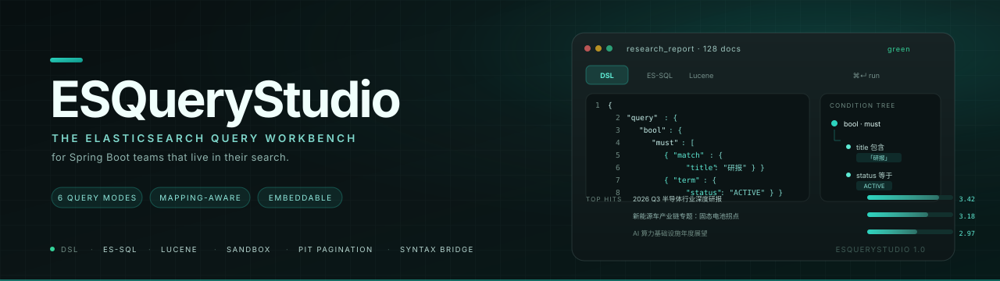
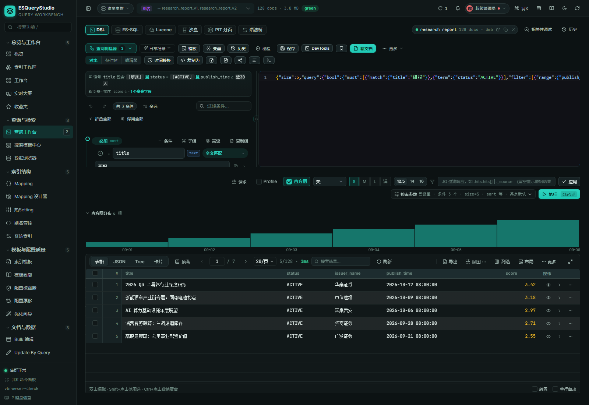
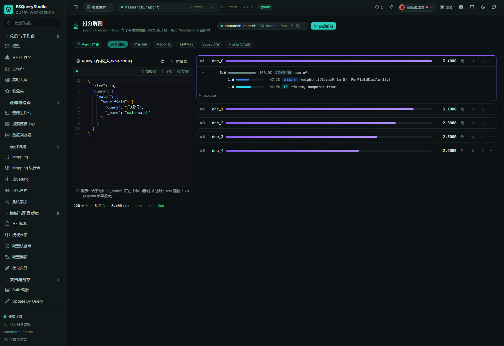
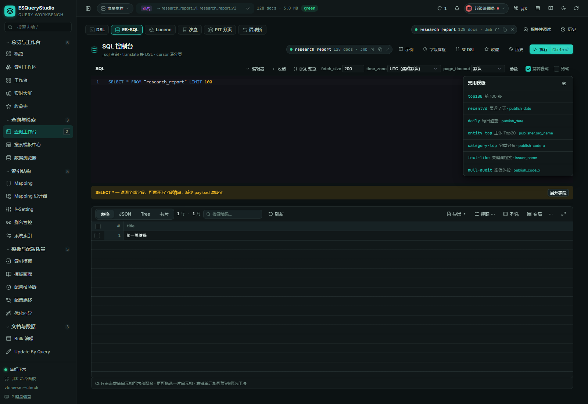
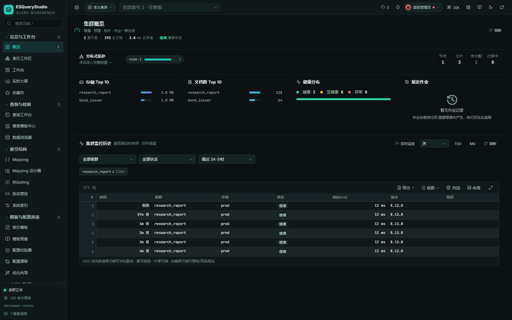
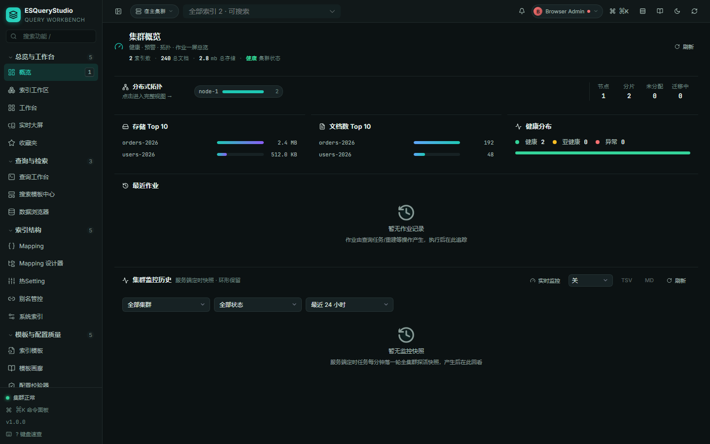
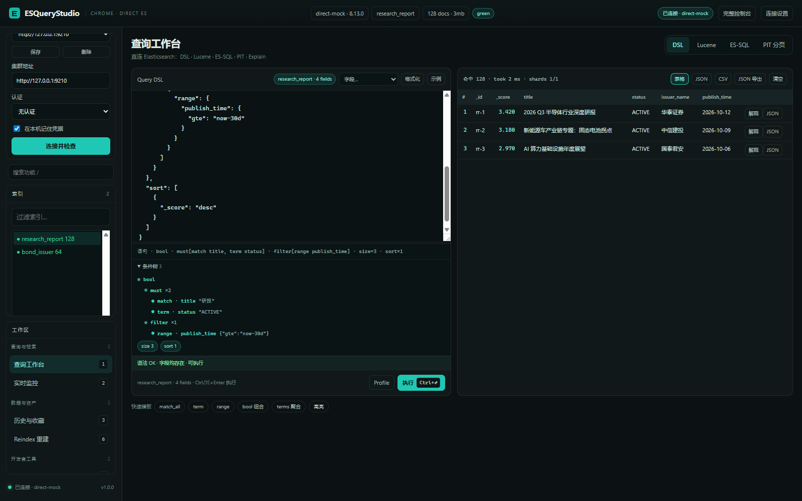
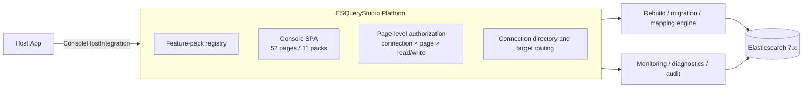

# ESQueryStudio · Elasticsearch Query Workbench

> **The Elasticsearch query workbench built for Spring Boot.** Six query modes share one live
> session: a DSL builder and raw editor in two-way sync, mapping / analyzer / version-aware
> completion and lint, score trees and Profile flames. Embed it in your host and it shares login,
> routes and permissions; 52 pages collapse into 11 feature packs.

[](https://github.com/dengmeiluan/esquerystudio/releases)
[](https://github.com/dengmeiluan/esquerystudio/actions/workflows/ci.yml)
[](https://openjdk.java.net)
[](https://spring.io/projects/spring-boot)
[](https://www.elastic.co)
[](LICENSE)
[](#contributing)
[](https://github.com/dengmeiluan/esquerystudio/actions/workflows/codeql.yml)
[](https://securityscorecards.dev/viewer/?uri=github.com/dengmeiluan/esquerystudio)



**[Five-minute integration](#-five-minute-integration)** · [中文 README](README.md) · [Query workbench](docs/query-workbench.md) · [Chrome extension](#-chrome-extension-native-vue-console-one-source-two-modes) · [Feature packs](#-feature-packs) · [Host integration](docs/integration/README.md) · [Architecture](docs/architecture.md)

---

## 🎯 Core: a query workbench that understands Elasticsearch

The star of ESQueryStudio is not another index-admin table. It is the **query workbench**: instead of
"remember DSL syntax, paste JSON, switch to another browser tab and read the result", you get one
continuous surface — condition tree on the left, raw request body on the right, results, histogram
and timing below. Switch to SQL, Lucene or PIT and the live session stays with you.

### Six modes, one session

| Mode | What you get |
|---|---|
| **DSL builder** | Condition tree ⇄ raw editor in two-way sync; 40+ clause types appear by field type, rare clauses have a dedicated entry, unknown clauses fall back to raw editing |
| **ES-SQL** | `_sql` queries, `cursor` deep pagination, field health check, table / JSON / Tree / card views, one-click SQL ⇄ DSL conversion |
| **Lucene** | Direct Lucene syntax, original highlights and hit rows preserved, can be carried into the builder for refinement |
| **Sandbox** | Free-form DSL, raw response inspection, `_source` and highlight comparison — for testing one hypothesis fast |
| **PIT pagination** | Stable deep pagination on Point-in-Time; a broken cursor is explained and resumable instead of stopping at the 10k window |
| **Syntax bridge** | SQL ⇄ DSL translation with semantic-difference hints; "translated" is not silently treated as "equivalent" |

### Not "a few autocomplete keywords" — it understands your index

- **Mapping-aware**: field types, `text` / `keyword` sub-fields, nested objects and date formats come from the live mapping of the current index; completion and lint never suggest something ES will reject.
- **Analysis-aware**: tokenizers, normalizers, synonyms and `analysis` settings feed the candidates; field-value enums come from the index instead of guesswork.
- **Version-aware**: `minVer` is labeled against the current cluster version, so 7.x vs 8.x differences are visible at the entry point instead of surfacing as "the query is wrong".
- **Two-way sync**: edit the tree, the JSON updates immediately; edit the JSON, the tree rebuilds semantically. One side never goes silently stale.
- **Lint is semantic**: missing fields, non-sortable types, `text` without `.keyword`, date-format mismatches and aggregation/sort conflicts all get actionable fixes before execution.
- **Replayable session**: cross-mode query history, favorites, drafts and shareable deep links share one session; switching modes, paging or refreshing never wipes a half-written query.

### From "why did this hit" to "why is it slow"

The workbench is not an isolated input box. It shares the query session with the relevance lab:

- **Score explain**: expand every hit's BM25 factor tree down to `tf` / `idf` / `boost` / `norm`.
- **Rank detective**: interrogate one document — why it won under this query versus another.
- **Query X-ray**: per-clause terms, hit counts and the post-analyzer query that ES actually ran.
- **Clause hit matrix**: which clause matched which document, aligned on one screen — catches "written but ineffective" conditions.
- **Profile flame graph**: expand `profile=true` query/collector timings to find whether time goes to rewrite, build_scorer or next_doc.

> These pages share `?idx=` and the query session; they are not six unrelated tools. All screenshots
> are from the real console (Mock ES data); no fake online demo is published.

---

## 🛳️ What it is

ESQueryStudio is an **embeddable Elasticsearch query and operations platform**, not a single-purpose
index-rebuild tool:

- **Query workbench** — DSL / ES-SQL / Lucene / sandbox / PIT / syntax bridge, mapping-aware completion, lint, tree ⇄ text sync, history and favorites.
- **Index lifecycle** — alias write-index flip + server-side `_reindex` for zero-downtime rebuilds; cross-cluster migration, reindex estimation, snapshots / SLM / ILM, and delete-resurrection compensation.
- **Observability and governance** — node KPIs, alerts, slow requests, top indices, task trees, topology, health reports, config drift and permission surfaces.
- **Host integration** — authentication delegation, connection directory, page-contract menus, branding and feature-pack selection through the `ConsoleHostIntegration` SPI, with no coupling to a specific business system.

### Who it is for

| What you are doing | What ESQueryStudio gives you |
|---|---|
| A Java / Spring Boot team using ES as the primary search or log store | No second Kibana deployment; the console ships with your app and login, routes, permissions and menus stay in the host |
| A search-quality / relevance team | Builder, score tree, rank detective, X-ray, hit matrix and Profile flame in one session |
| A platform team delivering "queryable, editable, governable" ES capability | Page-level authorization, feature-pack trimming, connection directory, audit contribution, standalone jar or embedded module |
| Rebuilding / migrating / capacity-tuning indices | Hosted rebuild, cross-cluster migration, reindex estimation, snapshots and lifecycle as one suite |

### What it is not

| It is | It is not |
|---|---|
| An Elasticsearch 7.x query / ops / governance workbench | A general-purpose BI or drag-and-drop dashboard builder |
| Deployable standalone or embeddable as a Spring Boot starter | Tied to a specific cloud or SaaS |
| A console whose product surface and auth can be owned by the host | A business system with built-in domain semantics |
| Page-level authorization (connection × page × read/write) | "Fake permissions" based on hidden menus |
| A `provided` contract: the host supplies the ES client stack | A bundle that forces a full ES client stack into the host classpath |

---

## 🧩 Why ESQueryStudio

1. **Workbench first**: make "write a query, read the result, explain the score, locate the slow part" one continuous flow — then grow index and operations capability around it, instead of stitching admin pages together.
2. **A real ES semantic layer**: mapping, analysis, version, field roles and sortability feed completion, lint, value enums and pre-execution checks, reducing "syntactically valid but semantically wrong".
3. **One platform, two shapes**: Kibana-style `java -jar` standalone, or embedded in a Spring Boot host sharing authentication and routing.
4. **Trimmable product surface**: 11 feature packs plus per-page exclusion; deep links to disabled modules land on an explainable "module not enabled" page instead of a blank or 404.
5. **Host-first SPI**: `ConsoleAuthDelegate`, `ConnStore`, `ConsoleAuditContributor` and `ConsoleHostIntegration` have clear roles; the page contract is the single source of truth for frontend navigation, backend page gates and host menu registration.

---

## 📦 Feature packs

All packs are on by default. List the packs you need in `esquerystudio.console.features.packs` to trim
the surface; `exclude-pages` hides individual pages on top. A feature pack is a **deployment
choice**, not a permission — authorization still comes from page-level read/write keys in
`grantedPages`.

| Pack | Pages | What you do inside |
|---|---:|---|
| `platform` | 5 | Overview, index workspace, workbench, live dashboard, favorites |
| `search` | 3 | Query workbench (DSL/SQL/Lucene/sandbox/PIT/bridge), search templates, data browser |
| `index` | 5 | Mapping and designer, hot settings, alias control, system indices |
| `quality` | 5 | Index templates, template gallery, config validation, config drift, optimizer |
| `data` | 3 | Bulk editor, Update By Query, document diff |
| `text` | 4 | Analyze validation, analyzer lab, synonym dictionary, analysis overview |
| `relevance` | 6 | Score explain, rank detective, boost tuner, hit matrix, query X-ray, Profile flame |
| `lifecycle` | 8 | Hosted rebuild, cross-cluster migration, advanced/estimated reindex, snapshots, SLM, ILM, lifecycle |
| `observe` | 9 | Diagnostics, health report, topology, Watcher, tasks/task tree, cluster settings, plugins, remote clusters |
| `security` | 1 | Security center: accounts, permission surface, ops audit |
| `devtools` | 3 | REST console, Dev Tools tabs, Painless sandbox |

> The page contract `META-INF/esquerystudio-pages.json` is the single source of truth: frontend
> navigation, backend page gates and the host menu registrar all derive from it. Feature packs
> change the exposed surface, not page keys.

**Page map** (13 groups / 52 pages, trimmable by group or page):

| Group | Pages | Representative capability |
|---|---:|---|
| `core` | 5 | Cluster overview, index workspace, Dev workbench, live dashboard, favorites |
| `search` | 3 | Six-mode query workbench, search templates, data browser |
| `index` | 5 | Mapping and designer, hot settings, alias control, system indices |
| `quality` | 5 | Index templates, template gallery, config validation, config drift, optimizer |
| `data` | 3 | Bulk editor, Update By Query, document diff |
| `text` | 4 | Analyze validation, analyzer lab, synonym dictionary, analysis overview |
| `rank` | 6 | Score explain, rank detective, boost tuner, hit matrix, query X-ray, Profile flame |
| `rebuild` | 4 | Hosted rebuild, cross-cluster migration, advanced/estimated reindex |
| `protect` | 4 | Snapshots, SLM, ILM, lifecycle |
| `health` | 4 | Diagnostics, health report, topology, Watcher |
| `cluster` | 5 | Tasks/task tree, cluster settings, plugins, remote clusters |
| `security` | 1 | Security center: accounts, permission surface, ops audit |
| `devx` | 3 | REST console, Dev Tools tabs, Painless sandbox |

---

## 🖥️ Console gallery

**Query workbench** — condition tree, raw DSL, histogram and result table on one screen; mapping-aware completion and lint update as you type:



**Score explain** — the BM25 factor tree for every hit, `tf` / `idf` / `boost` / `norm` expanded layer by layer:



**SQL console** — `_sql` queries, cursor deep pagination, field health check, multi-view results and DSL conversion:



**Cluster overview** — health, storage, document distribution and monitoring history:



### Ops console capabilities

- **Ad-hoc rebuilds** — guided zero-downtime rebuild: pick index → review settings/mapping → catch-up policy → confirm preview → watch execution.
- **Index workspace** — index list plus embedded document grid: filter / column stats / snapshot / export / inline edit.
- **Query workbench** — DSL / ES-SQL / Lucene / sandbox / PIT / syntax bridge with semantic completion and highlighting.
- **Data browser** — document CRUD, column stats, CSV / Markdown / XLSX export.
- **Cluster governance** — indices / aliases / mapping / ILM / snapshots / task tree / config drift / health reports.
- **Audit** — page-level grants (connection × page × read/write) plus host audit contribution.
- **Live monitoring** — node KPIs / alerts / slow requests / top indices across clusters.

---

## 🚀 Three delivery modes

### A. Standalone (Kibana-style)

```bash
java -jar esquerystudio-server.jar
```

Ships its own web server (default port `5601`) and ES client stack, with no host app required.
Open `http://localhost:5601/esquerystudio.html` and finish the Setup wizard against your control cluster.

The bootstrap profile persists under `~/.esquerystudio/` and survives restarts. See [apps/server/README.md](apps/server/README.md).

### B. Embedded console module

Add `esquerystudio-console` to a Spring Boot host and the console static resources and HTTP endpoints
register automatically; authentication can be delegated to the host (iframe shares the login).
Best for delivering one integrated product with your business system.

### C. Host integration (SPI-driven, host-agnostic)

ESQueryStudio does not require the host to become a particular business shape. Implement
`ConsoleHostIntegration` to declare branding and preferred packs, then add auth delegation,
connection directory and audit contribution as needed:

```java
@Bean
public ConsoleHostIntegration esQueryStudioHostIntegration() {
    return new ConsoleHostIntegration() {
        public String id() { return "acme"; }
        public String displayName() { return "Acme Search"; }
        public List<String> preferredPacks() {
            return Arrays.asList("platform", "search", "index", "data",
                    "lifecycle", "observe", "security", "devtools");
        }
    };
}
```

Every host-specific surface is an interface: `ConsoleAuthDelegate` (auth), `ConnStore` (connection
directory), `ConsoleAuditContributor` (audit), `ConsolePageCatalog` (menus). Full integration
surface and acceptance checklist: [docs/integration/README.md](docs/integration/README.md).

**Choose by scenario**:

| Your scenario | Use | Extra work |
|---|---|---|
| Operate one or more ES clusters standalone | `esquerystudio-server` jar | None; open the Setup wizard |
| You already have a Spring Boot app | `esquerystudio-console` embedded | Declare `@Document` entities; optional auth delegation |
| Integrate with host accounts, menus and audit | `esquerystudio-console` + host SPI | Implement `ConsoleHostIntegration` and `ConsoleAuthDelegate` |
| Only the rebuild / migration engine | `esquerystudio-console`, `mode=rebuild-only` | No console pages or static resources exposed |

---

## 🧩 Chrome extension: native Vue console, one source, two modes

The same `ui/` Vue console source powers both modes. Server mode keeps the Spring Boot
`/internal/es/index` backend; browser mode swaps only the transport and talks directly to
Elasticsearch from the extension. There is no second UI to drift. The extension's main page
is the full 52-page Vue console (browser build); first open asks for the ES URL, then routes,
components and styles are identical to server mode.





- **Server mode**: the same Vue source is served by the Spring Boot server through `/internal/es/index`; all 52 pages, 11 packs and host SPI remain.
- **Browser mode**: the extension runs the same Vue source in a `browser` build; the `api.ts` transport switches to direct Elasticsearch. The native connection layer stores credentials locally only.
- **Direct tool page**: right-click the extension icon for a lightweight debug page (DSL/Lucene/ES-SQL/PIT, Explain, REST, Reindex, monitor); it does not pretend to be the full console.
- **Coverage**: indices, mappings, settings, aliases, templates, snapshots, ILM/SLM, Watcher, tasks, nodes, REST, SQL, PIT, reindex, bulk, managed rebuild, cross-cluster migration (client `scroll` + `_bulk`) and config validation (L1 + L2 dry-run) work; monitor history/alerts, operation audit and rebuild/migration jobs are stored locally in IndexedDB/localStorage behind the same API contract.
- **Boundary**: system indices and config drift still need the server control plane and show an explicit notice; local monitoring samples once per minute (the page while open, the service-worker alarm otherwise), stays local and never fabricates history; accounts remain Elasticsearch-native.
- **Install**: open `chrome://extensions` → enable Developer mode → **Load unpacked** → select the folder containing `manifest.json` (`extensions/chrome` in the repo; extract the release zip first — do not select the zip itself).

Details and security notes: [extensions/chrome/README.md](extensions/chrome/README.md).

---

## ⚡ Five-minute integration

### 1. Add the dependency

```xml
<!-- Embedded console module (brings in the esquerystudio-platform kernel) -->
<dependency>
    <groupId>io.github.dengmeiluan</groupId>
    <artifactId>esquerystudio-console</artifactId>
    <version>1.0.0</version>
</dependency>
```

> **You supply the ES stack (provided contract)**: the starter does not transitively ship ES client
> libraries. Declare `spring-boot-starter-data-elasticsearch` and
> `elasticsearch-rest-high-level-client` in the host. At startup, `EsStackContractValidator`
> compares real type signatures (not version strings) and refuses to start with two actionable
> repair paths. See the [ES stack contract FAQ](docs/es-stack-contract.md).

### 2. Declare entities and hosted rebuilds

```java
@Document(indexName = "bond_quote")
public class BondQuoteES {
    @Id
    private String id;

    @Field(type = FieldType.Keyword)
    private String bondCode;

    @Field(type = FieldType.Text, analyzer = "ik_max_word", searchAnalyzer = "ik_smart")
    private String shortName;
}
```

At startup, new fields are safely registered into existing indices (mapping auto-register). When a
field type / analyzer changes or a new physical index is required, run the four-step hosted rebuild:

```text
new index (new mapping) → server-side _reindex backfill → atomic alias flip → observation → retire old index
```

Reads and writes never stop; documents deleted during the rebuild window are compensated after the
backfill, leaving no ghost data.

### 3. Platform configuration

```yaml
esquerystudio:
  console:
    branding:
      product-name: ESQueryStudio          # the host can rename the product
      tagline: The Elasticsearch query workbench built for Spring Boot
      integration-id: acme
      integration-name: Acme Search
    features:
      packs: [platform, search, index, lifecycle, observe, devtools]
      exclude-pages: []                 # hide individual pages, e.g. [security]
  elasticsearch:
    mode: console                       # rebuild-only: engine only; console: engine + UI
    console:
      store: sqlite                     # jobs + audit store: control-es / sqlite / jdbc
```

The platform layer (`esquerystudio.console.*`) and engine layer (`esquerystudio.elasticsearch.*`) are
separate: the former describes what the product looks like and which modules are exposed; the
latter holds rebuild / migration / storage runtime parameters.

### 4. HTTP endpoints

The mapping-reconcile entry points are exposed by `InternalEsIndexRebuildController` under
`/internal/es/index/`:

| Endpoint | Purpose |
|---|---|
| `POST /internal/es/index/rebuild` | Trigger a zero-downtime rebuild |
| `GET /internal/es/index/keys` | Enumerate registered `ManagedEsIndex` keys |
| `GET /internal/es/index/desired-state.html` | Desired-state page: business declares mapping expectations, host confirms before controlled execution |

### 5. Mapping auto-reconcile

At startup, `MappingReconcile` runs: with `esquerystudio.elasticsearch.mapping.auto-register=startup`,
new fields are added automatically; conflicts follow
`esquerystudio.elasticsearch.mapping.conflict-policy` (`fail` refuses startup / `warn` commits only
conflict-free additions). Conflict repair returns `USE_ADHOC_REBUILD` to route through hosted
rebuild. See [integration docs](docs/integration/README.md).

---

## 🏗️ Architecture



**Layers**: platform kernel (branding / feature packs / host SPI) → console module (query / index /
observability / security) → engine module (rebuild / migration / mapping). Feature packs are
declared at the contract layer; backend page gates still enforce the full contract.

### Project structure

```text
esquerystudio/
├─ platform/                 esquerystudio-platform: page contract, feature packs, branding, host SPI
├─ modules/console/          esquerystudio-console: engine + console + embedded UI assets
├─ apps/server/              esquerystudio-server: Kibana-style standalone deployment
├─ docs/                     architecture, integration and design documents
├─ ui/                       @esquerystudio/ui: Vue 3 console source
├─ extensions/chrome/       MV3 Chrome extension: direct ES query workbench
└─ examples/demo-host/       runnable host example
```

The engine and console packages still contain a dependency cycle
(auth ↔ multicluster ↔ xmigrate ↔ config), so `engine/` remains an isolated boundary directory
inside console until the interfaces are inverted and it can become its own artifact.

### Compatibility matrix

| Dimension | Supported range |
|---|---|
| JDK | 8+ (standalone jar and embedded alike) |
| Spring Boot | 2.3.x baseline; host 2.7.x verified |
| Elasticsearch | 7.x (7.6+ recommended; built-in 6.7 date compatibility converters) |
| OS | Linux / macOS / Windows, pure JVM |
| Delivery | Standalone jar, embedded module, host SPI, `rebuild-only` engine |
| Browser | Modern Chromium / Firefox / Safari, iframe embedding and theme following |

---

## 🎛️ Interaction constitution

The console is not "if it renders, it is done"; it is a testable set of constraints:

1. **Shortest path**: high-frequency actions are one click away; rare actions live in the ⋯ menu.
2. **Stable position**: after a state transition, the same action stays at the same pixel.
3. **State never resets**: paging / refresh / mode switch preserve filters, scroll, drafts and focus.
4. **Merge controls**: mutually exclusive or paired actions become a two-state button, segmented control or dropdown group.
5. **Overlay four elements**: surface + border + shadow + radius; Esc closes and returns focus to the trigger.
6. **Second channel parity**: right-click and the Menu key (Shift+F10) on table/list/card rows open the same menu; rows and clickable fragments are focusable, Enter/Space equal click; menu focus enters the first item, Home/End jump, Esc returns to the row.

Full clauses and delivery sequences: [docs/design.md](docs/design.md).

---

## ✅ Quality and verification

- **Frontend contract locks + real-browser behavior chains**: contract derivation, DSL round-trip, table kernel, permission gates, hotkeys and the right-click/Menu-key second channel all have source/behavior assertions; a keyboard-entry census guards new surfaces and goes red when one is missing.
- **Backend full gate**: Maven tests cover auth, page authorization, rebuild state machine, mapping reconcile, cross-cluster migration and storage tiers.
- **Real browser verification**: Mock ES + the real console, covering completion, lint, navigation trimming, disabled-module deep links and the permission matrix.
- **Negative controls**: illegal contracts, unknown feature packs and empty page grants must fail first and pass after the fix; "no error" is never accepted as proof.
- **Reproducible releases**: fixed `project.build.outputTimestamp`; the release profile produces sources/javadoc/SBOM; repeated builds of `platform` / `console` / `server` jars must have identical SHA-256.
- **Supply chain and security automation**: CodeQL, OpenSSF Scorecard, Dependency Review, Dependabot and a tag-driven Release workflow (version check, checksums, provenance attestation).

```bash
# Frontend
cd ui && npm ci
npm run typecheck          # vue-tsc 0
npm test                   # sharded full suite

# Backend
./mvnw clean package       # reuses the UI build automatically
./mvnw test -Dconsole.build.skip=true
```

---

## 🗺️ Roadmap

- [x] **Phase 1 · Query workbench**: six modes sharing one session, mapping-aware completion and lint, tree ⇄ text sync, relevance lab.
- [x] **Phase 2 · Platform and modules**: `platform` / `console` / `server` split, page contract, feature packs and host SPI.
- [x] **Phase 3 · ESQueryStudio 1.0**: unified brand and coordinates, bilingual README, demo host, integration docs and reproducible releases.
- [ ] **Phase 4 · Engine extraction**: break the `auth ↔ multicluster ↔ xmigrate ↔ config` cycle and ship rebuild/migration as a standalone artifact.
- [ ] **Phase 5 · Ecosystem and cost**: versioned page contract, plugin inventory, more host templates and a one-command bootstrap.

---

## 🛠️ Build from source

```bash
git clone https://github.com/dengmeiluan/esquerystudio.git
cd esquerystudio

# Frontend (Node 18+)
cd ui && npm ci && npm run build && cd ..

# Backend (JDK 8+; the reactor reuses the UI build)
./mvnw clean package

# Tests
cd ui && npm test && cd ..
./mvnw test -Dconsole.build.skip=true
```

Runnable example: [examples/demo-host](examples/demo-host/) — one `@Document` entity plus a
`@SpringBootApplication`, and the full query and ops console is up.

---

## Contributing

Issues and PRs are welcome. Before starting, read [CONTRIBUTING.md](CONTRIBUTING.md),
[architecture](docs/architecture.md), the [docs index](docs/README.md) and the
[design constitution](docs/design.md). Participation implies adherence to the
[Code of Conduct](CODE_OF_CONDUCT.md); decision and release process live in
[GOVERNANCE.md](GOVERNANCE.md), support channels in [SUPPORT.md](SUPPORT.md). For host integration,
extend through the SPI instead of hard-coding business fields into the platform.


## License

[Apache-2.0](LICENSE)
