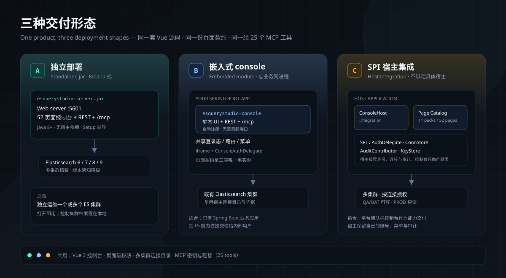

# 文档索引

按你的任务选择阅读路径。所有指南都与 ESQueryStudio 1.0.9 当前版本对齐。

> 在线演示（合成数据，点开即玩）：<https://dengmeiluan.github.io/esquerystudio/>

## 阅读路径

| 我在做什么 | 按顺序阅读 |
|---|---|
| **让 Agent 通过 MCP 访问 ES** | [MCP 快速开始](mcp-quickstart.md) → [MCP 接入](mcp.md) → [宿主集成清单](integration/README.md#宿主接入-mcp-检查清单) |
| 把控制台接入 Spring Boot 应用 | [README 快速接入](../README.md#-5-分钟接入) → [接入快速开始](integration/quickstart.md) → [配置参考](integration/configuration-reference.md) → [故障排查](integration/troubleshooting.md) |
| 运维控制台 | [期望状态](integration/desired-state.md) → [Mapping 冲突](integration/mapping-conflict-to-adhoc.md) → [故障排查](integration/troubleshooting.md) |
| 把控制台嵌入宿主 | [架构](architecture.md) → [宿主集成](integration/README.md) → [设计宪法](design.md) |
| 参与贡献代码 | [CONTRIBUTING](../CONTRIBUTING.md) → [架构](architecture.md) → [设计宪法](design.md) → [GOVERNANCE](../GOVERNANCE.md) |

## 文档地图

| 文档 | 用途 |
|---|---|
| [架构](architecture.md) | 模块、依赖规则、页面契约、运行时分层与交付形态 |
| [查询工作台](query-workbench.md) | 六种查询模式、语义补全、树 ⇄ 文本同步、相关性实验室 |
| [浏览器模式](browser-mode.md) | Chrome 扩展内的同一套 Vue 控制台：transport、本机存储、护栏执行与诚实边界 |
| [MCP 快速开始](mcp-quickstart.md) | 三接入面的最短接入路径、Claude/Cursor 配置、实时签发 key、连接级读写、错误码与 30 秒验收 |
| [MCP 接入](mcp.md) | 服务端 `/mcp`、stdio 桥、本地 Node MCP（多连接）、按用户/角色 API key 与频率配额、纯前端 `window.ESQueryStudioMCP` 与工具契约 |
| [Chrome 扩展](../extensions/chrome/README.md) | 前端直连查询工作台：能力、裁剪清单、安装与安全 |
| [Chrome 商店提交](../extensions/chrome/STORE-SUBMISSION.md) | 打包、商店字段、权限理由、审核与版本更新 |
| [隐私政策](privacy-policy.md) | Chrome 扩展的数据边界、权限、保留与删除方式 |
| [设计宪法](design.md) | 控制台的交互规则与视觉语言 |
| [集成索引](integration/README.md) | 业务端 / 宿主端接入指南索引 |
| [接入快速开始](integration/quickstart.md) | 第一个托管实体、Mapping 自动登记与重建 |
| [配置参考](integration/configuration-reference.md) | 每个配置键及其 Java 默认值 |
| [故障排查](integration/troubleshooting.md) | Mapping 对账、认证、重建与迁移失败 |
| [Mapping 自动登记](integration/mapping-auto-register.md) | 启动时机、写入边界与多实例行为 |
| [实体映射](integration/entity-mapping.md) | 用 Spring Data Elasticsearch 注解声明字段语义 |
| [期望状态](integration/desired-state.md) | 从业务应用复制期望并选择目标集群 |
| [Mapping 冲突](integration/mapping-conflict-to-adhoc.md) | 把不兼容的 Mapping 变更迁入托管重建 |
| [发布流程](releasing.md) | 版本对齐、标签驱动发布、构建产物、SBOM 与回滚 |
| [Release 正文](release-body.md) | 「初版（滚动更新）」的唯一发布说明源 |
| [LINUX DO 发帖材料](community/linux-do-post.md) | 社区开源推广声明、截图顺序与链接区 |
| [ES 栈契约](es-stack-contract.md) | 为什么 ES 客户端版本由宿主提供 |
| [安全策略](../SECURITY.md) | 凭据边界与漏洞报告 |
| [支持](../SUPPORT.md) | 在哪里提问、需要附上什么 |
| [治理](../GOVERNANCE.md) | 角色、决策与发布策略 |

## 文档规则

- 使用现在时，不写时间线、不写占位符。集成指南中的 `TODO`、`TBD`、`待补充`、`待完善` 会被文档契约测试拦截。
- 配置键写作 `esquerystudio.elasticsearch.*`（引擎）或 `esquerystudio.console.*`（平台），不引入兼容别名。
- 页面键与功能包 id 从 `platform/src/main/resources/META-INF/esquerystudio-pages.json` 派生。
- 截图必须来自真实控制台；不伪造演示状态。
