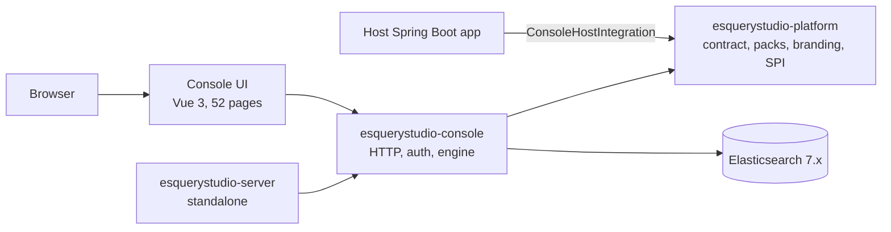

# Architecture

ESQueryStudio separates the product surface from the Elasticsearch engine so a host can adopt only the
parts it needs.

## System shape

## Modules

| Module | Artifact | Responsibility | May depend on |
|---|---|---|---|
| `platform` | `esquerystudio-platform` | Page contract, feature packs, branding, `ConsoleHostIntegration`, `ManagedEsIndex` | Spring Boot core only; no Elasticsearch client |
| `modules/console` | `esquerystudio-console` | Engine (rebuild, migration, mapping), console HTTP API, auth, audit, embedded UI assets | `platform`, host-provided Elasticsearch client |
| `apps/server` | `esquerystudio-server` | Bootable standalone app (Kibana-style), setup wizard, SQLite defaults | `esquerystudio-console` |
| `extensions/chrome` | MV3 extension | Native Vue console in `browser` mode: same `ui/` pages and components; direct-ES transport; local IndexedDB monitor/audit/job stores and client-side rebuild | `npm run build:extension` emits `app/`; server mode keeps `/internal/es/index` |
| `ui` | `@esquerystudio/ui` | Vue 3 + TypeScript console source, built into console static assets | Page contract via `@contract` |
| `examples/demo-host` | demo | Minimal host wiring for development | `esquerystudio-console` |

Dependency rule: `platform` never depends on Elasticsearch; `console` never depends on `server`.

## Page contract

`platform/src/main/resources/META-INF/esquerystudio-pages.json` is the single source of truth for:

- page keys, routes, groups, feature packs, hotkeys, and API prefixes;
- backend page-level authorization (`ConsolePageCatalog` and `ConsoleAuthInterceptor`);
- frontend navigation and command palette (built through the `@contract` alias);
- host menu provisioning (hosts may read the same resource from the classpath).

The contract is validated at load time; a missing or malformed contract fails startup instead of
silently producing an empty navigation or an authorization hole.

## Runtime layers

| Layer | Prefix | Owns |
|---|---|---|
| Platform | `esquerystudio.console.*` | Branding, integration identity, feature packs, excluded pages |
| Engine | `esquerystudio.elasticsearch.*` | Deployment mode, cluster bootstrap, rebuild/migration/mapping, storage, auth, monitoring |

`mode=client` installs only the client-side mapping/desired-state surface. `mode=console` installs the
full console and engine. `mode=rebuild-only` exists for engine-only adopters; the console pages and
static assets are not exposed.

## Host SPI

| Interface | Package | Purpose |
|---|---|---|
| `ConsoleHostIntegration` | `io.github.dengmeiluan.esquerystudio.platform.integration` | Branding and preferred feature packs |
| `ConsoleAuthDelegate` | `io.github.dengmeiluan.esquerystudio.console.auth` | Host authentication, roles, logout/revocation |
| `ConnStore` | `io.github.dengmeiluan.esquerystudio.console.multicluster` | Connection directory |
| `ConsoleAuditContributor` | `io.github.dengmeiluan.esquerystudio.console.auth` | Host audit contribution and merge |
| `ManagedEsIndex` | `io.github.dengmeiluan.esquerystudio.platform.spi` | Marks an entity as managed (legacy provider implementations are rejected) |

Hosts implement only the interfaces they need; the console falls back to its built-in behavior.

## Frontend composition

The console is composed from shared interaction kernels rather than per-view copies:

- `CellContextMenu` renders the shared right-click surfaces from a host-built `CcmItem[]` (viewport
  fitting, submenus, keyboard navigation, and z-index management in one place).
- `utils/menuKey.ts` is the shared predicate and anchor for row-menu keyboard entry: the Menu key
  and Shift+F10 open the same menu as the mouse, anchored to the focused row instead of 0,0.
  A census test fails when a component gains `@contextmenu` (template or render function) without
  a keyboard entry.
- `utils/rowNav.ts` moves focus between sibling rows (↑/↓, Home/End) for `data-row-nav` lists, and
  `utils/gridNav.ts` maps arrow keys onto matrix indices for the topology shard grid.
- `useQueryAccess` is the single source for the query workbench permission summary
  (target/env/role/read/write) used by the mode and current-index context menus.
- `FieldPicker`, builder `FieldSelect`, `MultiFieldPicker`, and `LuceneInput` share the same
  candidate-menu contract: choose/expand, toggle, fill, or copy without server-side writes.

New surfaces add behavior tests and register keyboard entries in the shortcuts panel instead of
forking these kernels.

## Deployment modes

| Mode | Entry | Use |
|---|---|---|
| Standalone | `java -jar esquerystudio-server.jar` | Operate one or more clusters without a host |
| Embedded console | `esquerystudio-console` in a host app | Share the host process, routes, and authentication |
| Host integration | `esquerystudio-console` + SPIs | Unified accounts, menus, connections, and audit |
| Engine only | `esquerystudio-console`, `mode=rebuild-only` | Mapping/rebuild automation without the console |

## Security boundaries

- The console uses page-level authorization: `conn:{connId}:{page}` for read and
  `conn:{connId}:w:{page}` for write; `null` grants mean page-level authorization is disabled.
- `mode=console` should use `ConsoleAuthDelegate` or a gateway in front of `/internal/es/**`.
- The engine never stores Elasticsearch credentials; connection secrets stay in the host/control
  plane and are omitted from list responses.

## Engine boundary and roadmap

The engine currently lives inside `modules/console` because `auth`, `multicluster`, `xmigrate`, and
`config` form package cycles. The `engine/` package is an explicit boundary; extracting it into a
standalone artifact is a roadmap item that follows the RFC process. Until then, `server` and hosts
consume the console artifact.

## Build and release

- Backend: Maven reactor, Java 8 bytecode, Spring Boot 2.3.x baseline.
- Frontend: Vite + Vue 3 + TypeScript, built into `modules/console/src/main/resources/static/esquerystudio`.
- Release builds use a fixed `project.build.outputTimestamp` for reproducible archives.
- CI runs backend tests, frontend shards, and typecheck. The release workflow attaches the server,
  platform, and console jars, sources/Javadocs, checksums, and an SBOM to a GitHub Release.
