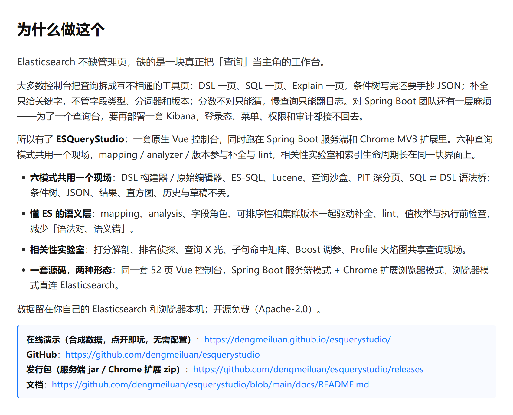
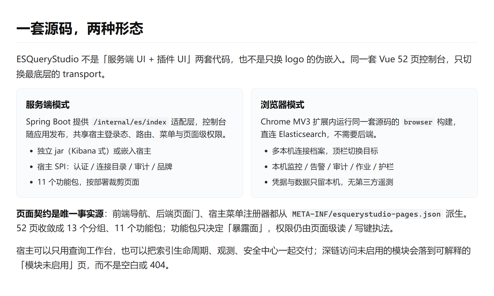
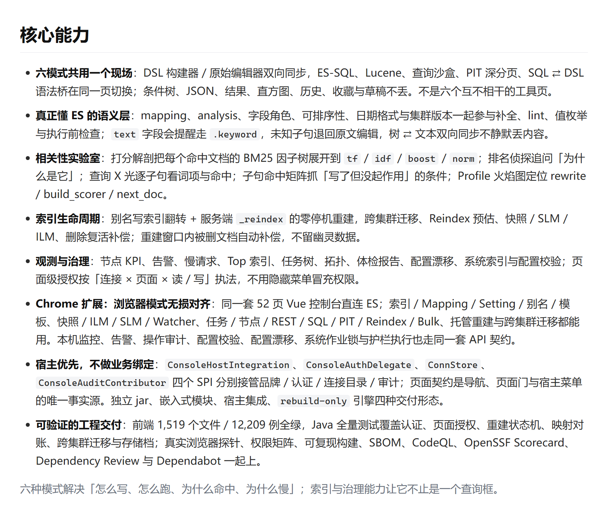
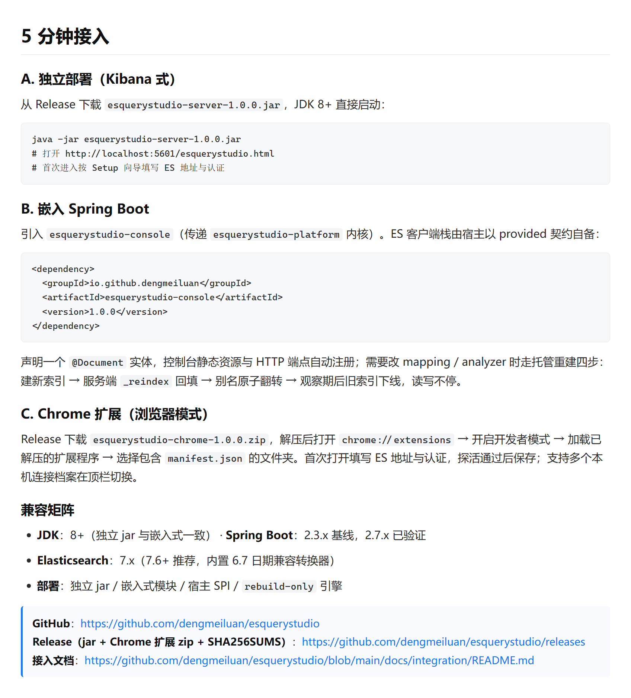
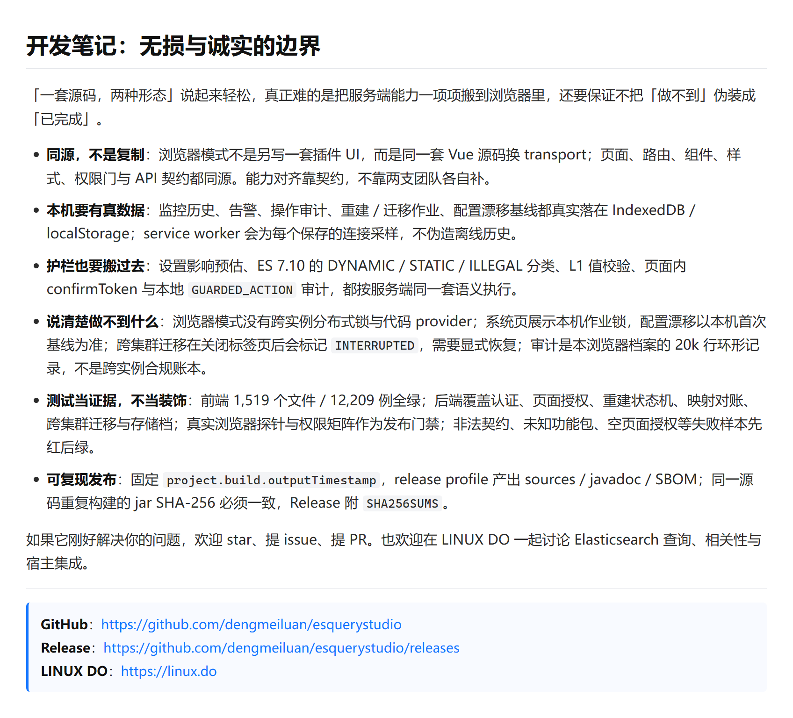
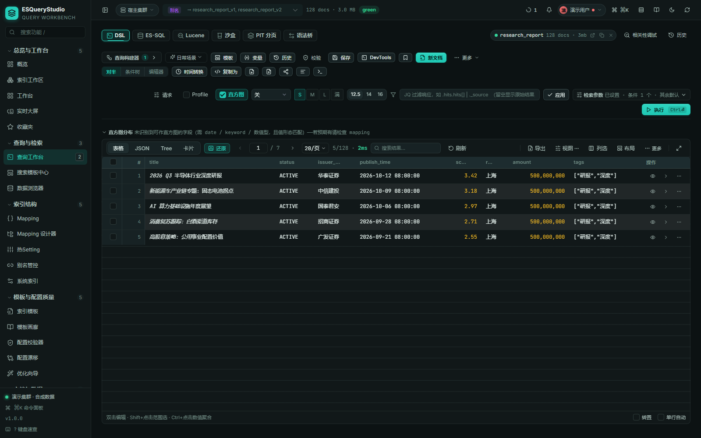
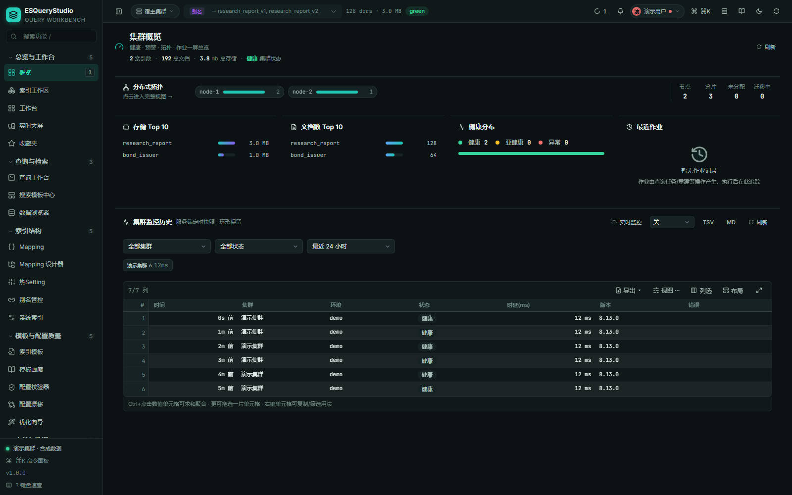
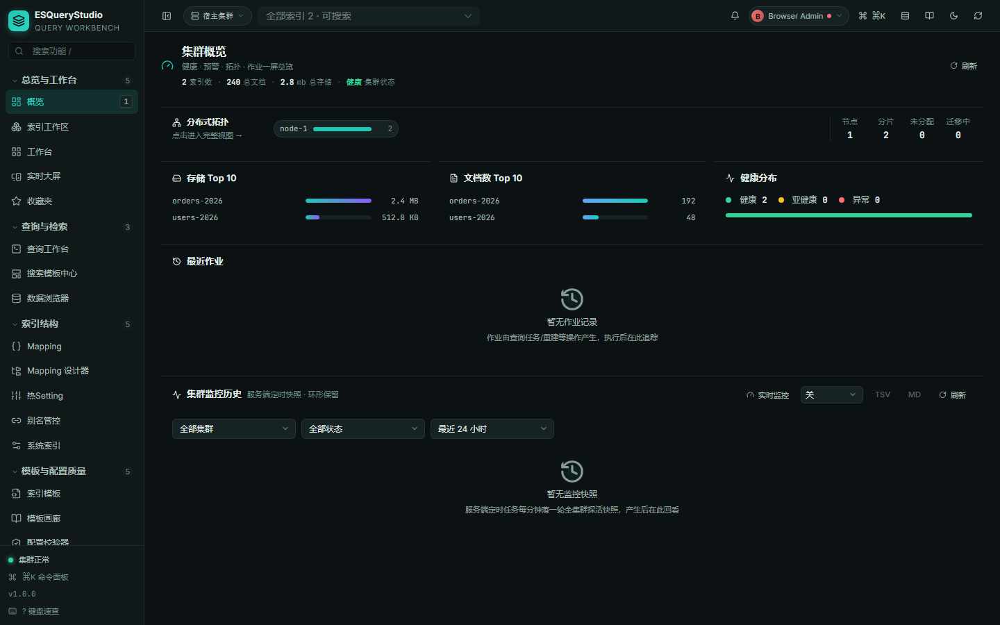

# ESQueryStudio：为 Spring Boot 而生的 Elasticsearch 查询工作台（开源）

> 发帖模板参考：<https://linux.do/t/topic/3018961>。以下“社区开源推广”声明与图片顺序均按该帖格式准备；正文介绍全部做成截图，发帖时按顺序上传。

## 一、社区开源推广声明（发帖正文开头，原样保留文字）

本帖使用社区开源推广，符合推广要求。我申明并遵循社区要求的以下内容：

- 我的帖子已经打上 **开源推广** 标签：是
- 我的开源项目完整开源，无未开源部分：是
- 我的开源项目已链接认可 LINUX DO 社区：是
- 我帖子内的项目介绍，AI 生成、润色内容部分已截图发出：是
- 以上选择我承诺是永久有效的，接受社区和佬友监督：是

以下为项目介绍正文内容，AI 生成、润色内容已使用截图方式发出。

## 二、链接区（发帖正文，可点击）

- 在线演示（合成数据，点开即玩，无需任何配置）：<https://dengmeiluan.github.io/esquerystudio/>
- GitHub：<https://github.com/dengmeiluan/esquerystudio>
- 发行包（服务端 jar / Chrome 扩展 zip / SHA256SUMS）：<https://github.com/dengmeiluan/esquerystudio/releases>
- 文档索引：<https://github.com/dengmeiluan/esquerystudio/blob/main/docs/README.md>
- LINUX DO 社区：<https://linux.do>

## 三、项目介绍截图（按顺序上传，正文只放图片）

1. 为什么做这个

2. 一套源码，两种形态

3. 核心能力

4. 5 分钟接入

5. 开发笔记：无损与诚实的边界

## 四、真实控制台截图（按顺序上传）

查询工作台：条件树、原始 DSL、直方图与结果同屏，mapping 感知补全和 lint 随输入更新。

集群概览：健康、存储、文档分布与集群监控历史。

Chrome 扩展：同一套 52 页 Vue 控制台在扩展内直连 Elasticsearch，多本机连接档案可在顶栏切换。

## 五、发帖检查清单

- 分类：`开发调优`
- 标签：`软件开发`、`开源项目`、`开源推广`
- 标题：`ESQueryStudio：为 Spring Boot 而生的 Elasticsearch 查询工作台（开源）`
- 正文只保留“社区开源推广声明”和链接；项目介绍、功能清单、接入步骤全部用上面的截图发出
- 图片上传顺序：01 → 02 → 03 → 04 → 05，再放 3 张真实控制台截图
- 发帖前确认在线演示、GitHub 仓库、Release、文档链接均可匿名访问
- 仓库 README 已加入 LINUX DO 社区链接与直达链接区
