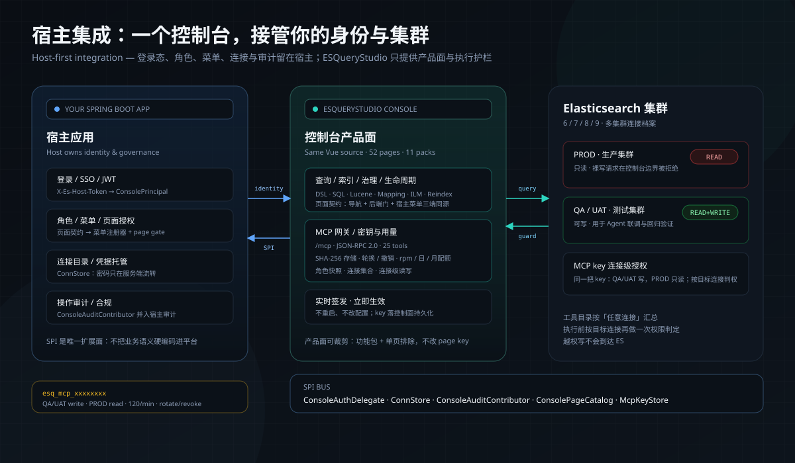

# ESQueryStudio 集成文档索引

业务应用接入方先读 client 侧自动登记与启动对账，宿主应用 运维方只在收到期望配置后进入控制台执行受控重建。

## 宿主接入 MCP 检查清单

- [ ] 打开 `esquerystudio.mcp.enabled=true`（一次装配开关；之后 key 实时创建，无需重启）。
- [ ] 宿主 Security 放行 `{context-path}/mcp`，不要把外部 MCP 客户端先拦在 JWT 过滤器。
- [ ] 选择 key 存储：默认控制集群索引 `esquerystudio_mcp_keys`；`console.store=jdbc` 时落宿主 `esquerystudio_mcp_key` 表。
- [ ] 在 **Dev Tools → MCP → 密钥与用量** 签发 key；生产连接只勾 read，QA/UAT 才勾 write。
- [ ] 若宿主实现自定义 `McpKeyStore`，实现连接级 `create` 重载；否则混合权限会明确失败，不会静默降权。
- [ ] 用 [MCP 快速开始](../mcp-quickstart.md) 的 30 秒验收确认 25 工具、生产写拒绝与用量计数。

| 文档 | 什么时候读 |
|---|---|
| [快速接入](quickstart.md) | 第一次给业务应用接入 ESQueryStudio，或升级到 2.x |
| [配置参考](configuration-reference.md) | 确认开关、默认值、允许值和失败语义 |
| [故障排查](troubleshooting.md) | 根据 `[MappingReconcile]` 状态或缺失日志定位问题 |
| [Mapping 自动登记](mapping-auto-register.md) | 评估启动时机、写入边界、多实例行为与依赖边界 |
| [实体 Mapping 写法](entity-mapping.md) | 用 Spring Data Elasticsearch 4.0.9 注解声明字段语义 |
| [期望配置交给 宿主应用](desired-state.md) | 从业务应用复制期望配置并安全选择真实目标集群 |
| [冲突转 Adhoc 重建](mapping-conflict-to-adhoc.md) | 日志出现 `CONFLICT` / `USE_ADHOC_REBUILD`，需要改变既有字段定义 |

默认接入从[快速接入](quickstart.md)开始；不要把 client 侧启动对账当成索引重建器。
