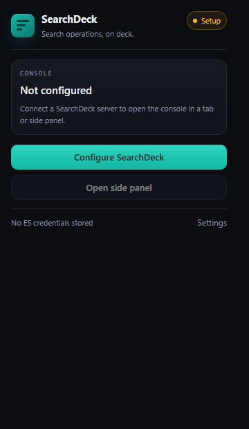

# Chrome extension

`extensions/chrome` is a Manifest V3 launcher for a running SearchDeck server. It is intentionally
small: the console, its session, and all Elasticsearch credentials stay on the server origin.



## Install (development)

1. Start a SearchDeck server (`java -jar apps/server/target/searchdeck-server-2.0.0.jar`).
2. Open `chrome://extensions`, enable **Developer mode**, then **Load unpacked** →
   `extensions/chrome`.
3. Open the extension options and save the console URL (`http://localhost:5601` for the standalone
   jar, or a host context path such as `https://host.example.com/ops`).
4. Use the toolbar popup, or the `open-side-panel` command (`Ctrl/Cmd+Shift+Y`).

The side panel and tab both load the server's own `/searchdeck.html` entry. The extension does not
bundle a second copy of the console.

## Permissions

| Permission | Why |
|---|---|
| `storage` | Persist the console URL and entry path |
| `sidePanel` | Open the workbench in Chrome's side panel |
| optional `http(s)://*/*` | Requested per saved origin; used for the reachability check and framed console |

Host access is never requested at install time. Chrome adds only the origin you save; revoke it from
the extension details page at any time.

## Security boundary

- No credentials or tokens are stored by the extension.
- No content scripts and no page injection.
- CSP is `script-src 'self'`; all extension code is local and loaded as ES modules.
- The console is remote UI from your own server, not remote code executed in the extension context.
- The reachability check uses `credentials: 'omit'` and does not authenticate.

## Limitations

- The server must be reachable from the browser. A server behind a private network needs the browser
  to join that network (VPN, proxy, or a reachable gateway).
- If the console is served over HTTP while an extension page is HTTPS, Chrome's mixed-content rules
  apply to the framed page; prefer HTTPS for remote hosts.
- A host that forbids framing (CSP `frame-ancestors`) can still be opened in a tab; the side panel
  will show the blocked frame.
- Chrome 116+ is required for `chrome.sidePanel`.

## Validation

```bash
node --test extensions/chrome/test/*.test.mjs
chrome --pack-extension=extensions/chrome --no-message-box   # local manifest validation
```

The package is the `extensions/chrome` directory itself; upload it to the Chrome Web Store or load it
unpacked. Remove the `.crx`/`.pem` files generated by `--pack-extension`.
