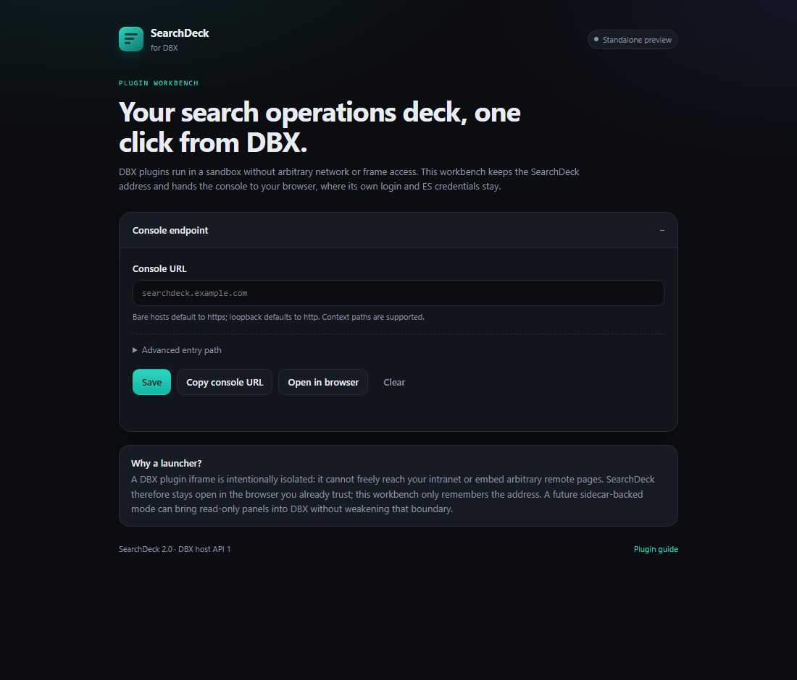

# DBX plugin

`extensions/dbx` packages SearchDeck as a frontend-only **DBX plugin** (Manifest v1, host API 1).
It adds a SearchDeck workbench that stores a console URL and opens it in your browser.



## Why a launcher

DBX plugin UIs are sandboxed iframes:

- `sandbox="allow-scripts"` with a restrictive CSP;
- no arbitrary network access (a plugin may declare up to eight fixed
  `host.network:https://<origin>` entries for `connect-src`);
- no Tauri or local filesystem access;
- no general-purpose remote frame embedding in the plugin contract.

A user-configurable SearchDeck origin cannot be expressed as a static `host.network` entry, so
embedding the full console directly would either fail or require weakening the sandbox. The launcher
keeps the boundary intact: DBX remembers the address, while the console and its credentials remain in
the browser.

## Install (development)

1. Build the package:

   ```bash
   cd extensions/dbx
   npm test
   python scripts/package.py
   python scripts/verify_package.py
   ```

2. In DBX, open **Plugin Center** and enable **Allow unsigned development package**.
3. Install `dist/io.github.dengmeiluan.searchdeck-<version>-universal.dbxp`.
4. Open the **SearchDeck** workbench, save a console URL, then use **Copy console URL** or
   **Open in browser**.

The package is unsigned. Official distribution requires the DBX Marketplace signing flow; do not
publish an unsigned candidate as a signed release.

## Full-console options

When the goal is to work inside DBX rather than launch a browser, there are three honest paths:

| Path | What it needs | Boundary |
|---|---|---|
| Sidecar-backed panels | A native DBX sidecar proxies SearchDeck APIs; plugin renders a compact read-only/dashboard UI | Recommended; keeps the plugin sandbox intact |
| First-class framed console | A DBX host contribution that allowlists frames/webviews with reviewable origins | Requires a DBX host change |
| Compact native workbench | A build-time fixed SearchDeck origin and a subset of pages (health, indices, saved queries) | Only for a known deployment, not a generic marketplace plugin |

The launcher ships first because it is safe, useful, and does not trade security for reach.

## Manifest and packaging

- Manifest paths are package-relative and validated by DBX; the UI entry is `ui/index.html`.
- `scripts/package.py` writes a deterministic `.dbxp` (a zip with `manifest.json` at its root).
- `scripts/verify_package.py` rejects development files and missing UI assets.
- Tests compare URL normalization with the Chrome extension module so both launchers agree on
  scheme defaults, context paths, and rejection rules.

```bash
cd extensions/dbx
npm test
```
