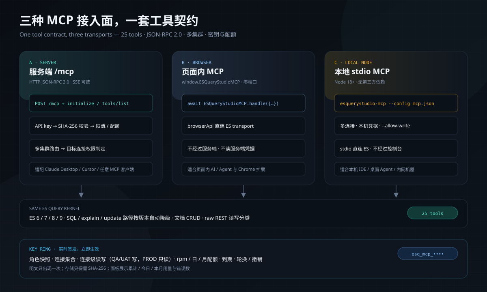
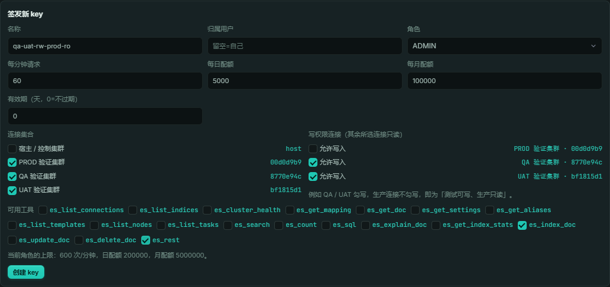

# MCP 快速开始



ESQueryStudio 把 MCP 做成产品的一等公民，而不是控制台旁边的脚本：
服务端、浏览器页面内、本地 Node 三种接入面共用一套工具契约；key 按登录人/角色签发，
可按连接设置 read/write，实时轮换、撤销与计量。

| 接入面 | 一条命令 / 一个对象 | 适合 |
|---|---|---|
| 服务端 | `POST {context-path}/mcp` JSON-RPC 2.0 | Claude Desktop、Cursor、任意 MCP 客户端；需要多集群与配额 |
| 浏览器 | `window.ESQueryStudioMCP.handle(...)` | 页面内 AI / Agent、控制台插件自动化；零端口 |
| 本地 Node | `esquerystudio-mcp --config mcp.json`（stdio） | 本机 IDE / 桌面 Agent；直连 ES，无 Spring Boot |

完整工具表、错误语义与架构见 [MCP 接入](mcp.md)。

## 1. 服务端模式（推荐给团队 / 生产）

### 1.1 打开能力

```yaml
esquerystudio:
  mcp:
    enabled: true
```

- 这是**一次性装配开关**：决定 `/mcp` 与密钥管理端点是否存在。
- 日常使用不需要在配置里写 key。key 发版后在面板或 API **实时创建**，立即生效。
- QuoteHub 已默认开启；宿主自己的 Spring Security 需要像放行 `/esquerystudio.html` 一样放行 `/mcp`。

### 1.2 创建第一把 key

顶栏有一个常驻 **MCP** 按钮（插头图标），点击直接进入 **Dev Tools → MCP**；
也可以手动打开 **开发者工具 → Dev Tools**，再点页面工具栏的 **MCP**。


进入 **密钥与用量 → 签发密钥**：



也可以直接调管理 API（使用控制台登录态，不是 MCP key）：

```bash
curl -s http://localhost:5601/internal/es/index/mcp/keys \
  -H "Authorization: Bearer <console-token>" \
  -H 'Content-Type: application/json' \
  -d '{
    "name": "ci-agent",
    "role": "OPERATOR",
    "connections": ["host"],
    "permissions": ["read"],
    "allowedTools": ["es_search", "es_count", "es_get_mapping"],
    "requestsPerMinute": 60,
    "dailyQuota": 5000,
    "monthlyQuota": 100000,
    "expiresInDays": 30
  }'
```

响应里的 `secret` 只出现一次。存储只保留 SHA-256；管理面永远不回显明文。

### 1.3 接 Claude Desktop / Cursor

使用仓库自带的 stdio 桥把本地 MCP 客户端转发到 HTTP 端点：

```json
{
  "mcpServers": {
    "esquerystudio": {
      "command": "node",
      "args": ["/path/to/esquerystudio/mcp/esquerystudio-mcp-stdio.mjs"],
      "env": {
        "ESQ_MCP_URL": "http://localhost:5601/mcp",
        "ESQ_MCP_TOKEN": "esq_mcp_xxxxxxxx.yyyyyyyy"
      }
    }
  }
}
```

QuoteHub 部署的 context path 是 `/quotehub`，端点对应为
`http://<host>:7788/quotehub/mcp`。

## 2. 浏览器模式（零端口）

浏览器构建会在页面内安装同一套 JSON-RPC 入口：

```js
await window.ESQueryStudioMCP.handle({
  jsonrpc: '2.0',
  id: 1,
  method: 'tools/list'
});

await window.ESQueryStudioMCP.callTool('es_search', {
  index: 'research_report',
  query: { match_all: {} },
  size: 5
});
```

读工具使用当前浏览器连接；写工具默认关闭，需在 MCP 面板显式打开。
浏览器标签页不能监听 TCP，外部进程客户端请走服务端或本地 Node。

## 3. 本地 Node 模式（给本机 Agent）

```bash
# 仓库内直接运行
node mcp/esquerystudio-local-mcp.mjs --config ~/.esquerystudio/mcp.json

# 或安装为全局命令（Node 18+，无第三方依赖）
cd mcp && npm install -g . && esquerystudio-mcp --config ~/.esquerystudio/mcp.json
```

`mcp.json`：

```json
{
  "defaultConnection": "qa",
  "connections": [
    { "id": "qa",  "name": "QA",  "url": "https://qa-es.example:9200",  "apiKey": "base64-id:key" },
    { "id": "prod","name": "PROD","url": "https://prod-es.example:9200", "apiKey": "base64-id:key" }
  ]
}
```

本地配置里的凭据只在 Node 进程内；默认只读，写工具需要显式加 `--allow-write`。
浏览器模式可在 **Dev Tools → MCP → 导出 Node MCP 配置** 生成同结构文件。

## 4. 一把 key 覆盖多环境：QA/UAT 可写、生产只读

`connectionPermissions` 是连接级权限覆盖；未列出的连接沿用全局 `permissions`。

```json
{
  "name": "qa-uat-rw-prod-ro",
  "role": "ADMIN",
  "connections": ["qa", "uat", "prod-1", "prod-2"],
  "permissions": ["read"],
  "connectionPermissions": {
    "qa":     ["read", "write"],
    "uat":    ["read", "write"],
    "prod-1": ["read"],
    "prod-2": ["read"]
  },
  "allowedTools": ["es_search", "es_count", "es_rest", "es_index_doc"]
}
```

调用时必须带目标连接：

```json
{
  "jsonrpc": "2.0",
  "id": 2,
  "method": "tools/call",
  "params": {
    "name": "es_rest",
    "arguments": {
      "connection": "qa",
      "method": "PUT",
      "path": "/probe_20261107"
    }
  }
}
```

把 `connection` 换成 `prod-1`，同样的 PUT 会在控制台边界被拒绝，不会到达生产 ES。
工具目录按“任意连接”汇总；真正执行时按目标连接再判一次。

## 5. 频率、配额与错误

| HTTP / 结果 | 含义 | 处理 |
|---|---|---|
| `401` + `INVALID_MCP_KEY` / `MCP_KEY_REVOKED` | key 无效、已撤销或已过期 | 在面板重新签发或轮换 |
| `429` + `Retry-After` | 超过 `requestsPerMinute`（固定 60 秒窗口） | 按秒数退避 |
| `429` + `MCP_DAILY_QUOTA_EXCEEDED` / `MCP_MONTHLY_QUOTA_EXCEEDED` | 日/月配额（UTC）用尽 | 调整配额或等次日/次月 |
| `result.isError=true` + `Connection ... is read-only` | 目标连接只读 | 改用可写连接，或由 ADMIN 调整连接级权限 |
| `result.isError=true` + `Tool not allowed for this key` | 工具不在白名单 | 在签发时勾选工具 |
| `result.isError=true` + `Connection not allowed for this key` | 目标连接不在连接集合 | 重建 key 或改用已授权连接 |

## 6. 30 秒验收

```bash
# 1) 握手
curl -s "$ESQ_MCP_URL" \
  -H "Authorization: Bearer $ESQ_MCP_TOKEN" \
  -H 'Content-Type: application/json' \
  -d '{"jsonrpc":"2.0","id":1,"method":"initialize","params":{"protocolVersion":"2025-06-18","clientInfo":{"name":"verify","version":"1"}}}'

# 2) 工具目录（服务端/浏览器/本地 Node 都应有 25 个工具）
curl -s "$ESQ_MCP_URL" \
  -H "Authorization: Bearer $ESQ_MCP_TOKEN" \
  -H 'Content-Type: application/json' \
  -d '{"jsonrpc":"2.0","id":2,"method":"tools/list"}'

# 3) 生产写应被拒绝
curl -s "$ESQ_MCP_URL" \
  -H "Authorization: Bearer $ESQ_MCP_TOKEN" \
  -H 'Content-Type: application/json' \
  -d '{"jsonrpc":"2.0","id":3,"method":"tools/call","params":{"name":"es_rest","arguments":{"connection":"prod-1","method":"PUT","path":"/should-not-exist"}}}'
```

## 7. 安全边界

- 明文 key 只在创建/轮换响应出现一次；存储只保留 SHA-256。
- key 绑定签发时的 `owner` / `role` 快照；角色变更后应撤销旧 key 再签发。
- 任意登录人都可为自己签发 key；key 的连接、工具和连接级读写只能落在本人页面授权范围内，不能代签、不能提权。
- 频率与配额在进程内计数；多实例部署时每实例独立，严格全局配额请由网关按 key 维度实施。
- 宿主自己注册 `McpKeyStore` 时，新的连接级权限重载默认**明确报错**，不会静默丢弃权限。
