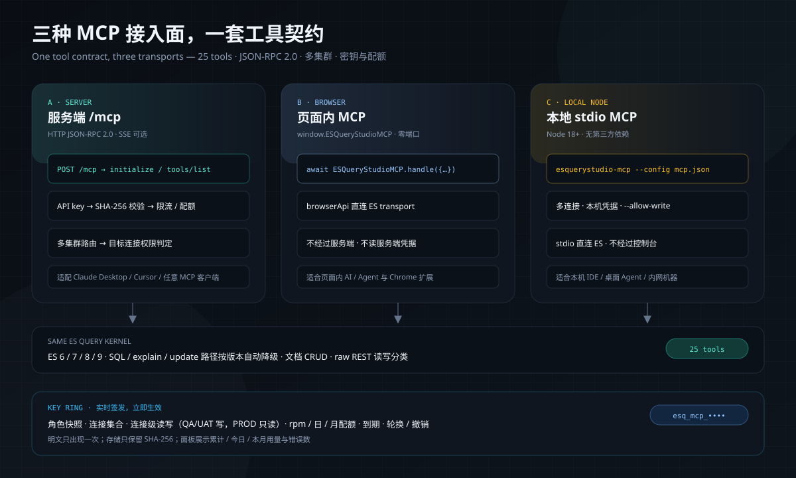

# MCP 接入



ESQueryStudio 提供三种 MCP（Model Context Protocol）接入面：服务端模式的标准 HTTP JSON-RPC、纯前端模式的内页 JSON-RPC 桥，以及本地 Node stdio 桥。三者共用同一组工具契约（读工具 + 显式授权的写工具），避免出现「服务端一套、前端另一套」的能力漂移。

第一次接入建议先读 **[MCP 快速开始](mcp-quickstart.md)**（含 Claude/Cursor 配置、实时签发 key、连接级读写与 30 秒验收）。

**目录：** [能力矩阵](#能力矩阵) · [服务端模式](#服务端模式) · [API key 与配额](#api-key角色与配额推荐) · [stdio 桥](#stdio-桥claude-desktop--cursor) · [本地 Node](#本地-node-mcp无-spring-boot--无浏览器) · [纯前端](#纯前端模式) · [工具表](#工具) · [REST 分类](#raw-rest-的读写分类) · [ES 6/7/8/9](#es-6--7--8--9-兼容) · [验证](#验证)

## 能力矩阵

| 模式 | 接入方式 | 适合谁 | 边界 |
|---|---|---|---|
| 服务端模式 | `POST /mcp`（JSON-RPC 2.0）+ 可选 stdio 桥 | Claude Desktop、Cursor、任意 MCP 客户端 | 需要启用 `esquerystudio.mcp.enabled`；支持服务级 Bearer token 或按登录人/角色签发的 API key |
| 纯前端模式 | `window.ESQueryStudioMCP` | 页面内 AI / Agent、控制台插件内的自动化 | 浏览器标签页不能监听 TCP；外部进程客户端请使用服务端模式，或在本地桥中复用同一套工具契约 |
| 本地 Node 模式 | `mcp/esquerystudio-local-mcp.mjs`（stdio） | 本地 Claude Desktop / Cursor / Agent，无 Spring Boot、无浏览器 | Node 18+ 直连 ES；多连接配置在本机；写工具默认关闭，需 `--allow-write` |

纯前端的工具执行仍走 `browserApi` 的直连 ES transport；不经过服务端，不读取服务端凭据。

## 服务端模式

### 启用

```yaml
esquerystudio:
  mcp:
    enabled: true
    token: change-me
```

`token` 是服务级自举 token（拥有全部工具）；未设置时，若 key 存储可用仍可用 API key 认证。缺少或错误的 Bearer 凭证返回 `401`，撤销/过期的 key 同样返回 `401`。key 默认只读；写工具仍须在目标连接上有 `write` 授权。

MCP 端点同时受 `esquerystudio.elasticsearch.web-enabled` 约束（默认 `true`）；显式关闭 Web 面时端点不会装配，避免出现「控制台已关闭、MCP 仍对外」的旁路。

宿主应用如果有自己的 Spring Security，需像放行 `/esquerystudio.html` 一样放行 `/mcp`（含 context-path）；MCP 的 Bearer API key 由 starter 校验，不能被宿主的 JWT 过滤器提前拦掉。

### API key、角色与配额（推荐）

日常接入建议使用控制台 **Dev Tools → MCP → 密钥与用量** 签发 key，而不是共享服务级 token：

- key 绑定签发时的 `owner` 与 `role`。任意登录人都可为本人签发，但连接、工具和连接级读写只能落在本人页面授权范围内；ADMIN 可代任意用户签发、查看全部、撤销任意 key。key 访问连接时还要满足该连接的 `minRole`；角色不足的连接不能签发，也不能在调用时越过。
- 非 ADMIN 的可用工具受其页面授权收窄（`search` / `mapping` / `score-explain` / `indices` / `overview`）；ADMIN 不受页面收窄。
- 每个 key 独立设置 `allowedTools`、`connections`（ADMIN 可选全部连接；非 ADMIN 只能选自己有页面授权的连接）、`permissions`（全局 read；写权限用 `connectionPermissions` 逐连接授予）、`requestsPerMinute`（固定 60 秒窗口）、`dailyQuota`、`monthlyQuota`、`expiresInDays`；每个用户最多 10 把活跃 key（ADMIN 100 把），防止用多把 key 绕过单 key 配额。
- `connectionPermissions` 支持连接级权限覆盖：同一把 key 可以让 QA/UAT 为 `["read","write"]`、生产连接为 `["read"]`，未列出的连接沿用 `permissions`。工具清单按「任意连接」汇总，真正执行时按目标连接再判一次，越权写返回 tool error（不会把生产写请求发给 ES）。
- 明文 `esq_mcp_...` 只在创建响应出现一次；存储只保留 SHA-256，管理面永远不回显明文。
- 频率超限返回 `429` + `Retry-After`；日/月配额超限也返回 `429`。用量（累计/今日/本月请求数、错误数、最近使用时间）在面板展示。
- key 记录默认落在控制集群索引 `esquerystudio_mcp_keys`；可用 `esquerystudio.elasticsearch.console.mcp-key-index-name` 改索引名。首次写入自动创建；若集群关闭了动态建索引，请预先建好该索引。
- **持久化档**：`esquerystudio.elasticsearch.console.store=jdbc` 时自动改用宿主 `DataSource` 的 `esquerystudio_mcp_key` 表（首次使用幂等建表），key、连接、权限与用量计数跨重启保留；`control-es` 时用控制集群索引。宿主还可自定义 `McpKeyStore` Bean 完全接管。
- 面板里的请求数是**工具调用**口径（`tools/call`），可直接对接外部计费/账单系统；`requestCount` 是累计值，`todayCount` / `monthCount` 按 UTC 自然日/月重置。每个 key 还持久化 `toolCounts`（按工具名计数，管理面按调用量倒序返回前 20 项）与 `lastTool`，方便按工具维度计费/排查。
- **实时创建、实时管理**：发版时只需要一次能力开关（`esquerystudio.mcp.enabled`，QuoteHub 已默认开启）；之后在 **Dev Tools → MCP → 密钥与用量** 或 `POST /internal/es/index/mcp/keys` 签发、轮换、撤销 key，立即生效，不需要重启、不需要改 `application.yml`、不需要重新发版。频率/配额/用量按 key 实时累计。

混合环境 key 示例（测试可写、生产只读）：

```json
{
  "name": "qa-uat-rw-prod-ro",
  "role": "ADMIN",
  "connections": ["qa", "uat", "prod-1", "prod-2"],
  "permissions": ["read"],
  "connectionPermissions": {
    "qa":  ["read", "write"],
    "uat": ["read", "write"],
    "prod-1": ["read"],
    "prod-2": ["read"]
  },
  "allowedTools": ["es_search", "es_count", "es_rest", "es_index_doc"]
}
```

| 角色 | 查看 key | 签发 | 撤销 |
|---|---|---|---|
| VIEWER | 自己的 | 本人，按页面授权范围 | 自己的 |
| OPERATOR / rank3 | 自己的 | 本人，按页面授权范围 + 角色配额上限 | 自己的 |
| ADMIN | 全部 | 任意用户/角色；可选连接集合与 read/write 权限 | 任意 |

| 角色 | 每分钟上限 | 每日上限 | 每月上限 | 有效期上限 |
|---|---|---|---|---|
| OPERATOR | 120 | 20,000 | 500,000 | 90 天 |
| rank3（REBUILD_OP / CLUSTER_OP / AUDIT_OP） | 300 | 50,000 | 1,000,000 | 90 天 |
| ADMIN | 600 | 200,000 | 5,000,000 | 3650 天 |

管理面端点（使用控制台登录态，不是 MCP key）：

- `GET /internal/es/index/mcp/keys`：当前身份可见的 key + 角色上限 + 可用工具。
- `POST /internal/es/index/mcp/keys`：签发；响应中的 `secret` 只出现这一次。
- `POST /internal/es/index/mcp/keys/{id}/rotate`：轮换自己的 key（保留权限/用量，旧明文立即失效）；ADMIN 可轮换任意 key。
- `POST /internal/es/index/mcp/keys/{id}/revoke`：撤销自己的 key；ADMIN 可撤销任意 key。

限流计数在进程内完成。多实例部署时每个实例独立计数，严格的全局配额应在网关或宿主侧按 key 维度实施——这是一个明确的部署边界，不是伪造的分布式配额。宿主可以注册自己的 `McpKeyStore` Bean 替换默认的 ES 存储（例如 QuoteHub 的数据库存储），管理面与 `/mcp` 认证会继续复用同一 SPI。

### 端点

- `GET /mcp`：返回协议版本、serverInfo、工具目录和 transport 信息。
- `POST /mcp`：JSON-RPC 2.0，支持：
  - `initialize`
  - `notifications/initialized`
  - `ping`
  - `tools/list`
  - `tools/call`

```bash
curl -s http://localhost:5601/mcp \
  -H 'Authorization: Bearer change-me' \
  -H 'Content-Type: application/json' \
  -d '{"jsonrpc":"2.0","id":1,"method":"tools/list"}'
```

### stdio 桥（Claude Desktop / Cursor）

只支持 stdio 启动命令的客户端使用 `mcp/esquerystudio-mcp-stdio.mjs` 转发到服务端端点：

```json
{
  "mcpServers": {
    "esquerystudio": {
      "command": "node",
      "args": ["/path/to/esquerystudio/mcp/esquerystudio-mcp-stdio.mjs"],
      "env": {
        "ESQ_MCP_URL": "http://localhost:5601/mcp",
        "ESQ_MCP_TOKEN": "esq_mcp_xxxxxxxx.xxxxxxxx"
      }
    }
  }
}
```

### 本地 Node MCP（无 Spring Boot / 无浏览器）

如果只有本地客户端 Agent（Claude Desktop、Cursor、命令行 Agent），又不想启动 Spring Boot，可直接用 Node 直连 ES：

```bash
# 方式 A：仓库内直接运行（无需安装依赖）
node mcp/esquerystudio-local-mcp.mjs --config ~/.esquerystudio/mcp.json
# 方式 B：本机安装为命令（Node 18+，无第三方依赖）
cd mcp && npm install -g . && esquerystudio-mcp --config ~/.esquerystudio/mcp.json
# 单连接环境变量形态
ESQ_ES_URL=http://localhost:9200 ESQ_ES_USERNAME=elastic ESQ_ES_PASSWORD=*** \
  node mcp/esquerystudio-local-mcp.mjs
```

浏览器模式配好连接后，可在 **Dev Tools → MCP → 导出 Node MCP 配置** 直接生成
`esquerystudio-mcp.json`，再让本地 Node MCP 读取；文件包含本机凭据，保存到受限目录。

`mcp.json` 支持多连接：

```json
{
  "defaultConnection": "prod",
  "connections": [
    { "id": "prod", "name": "生产", "url": "http://localhost:9200", "username": "elastic", "password": "***" },
    { "id": "qa", "name": "QA", "url": "https://qa.example:9200", "apiKey": "base64-id:key" }
  ]
}
```

客户端配置示例：

```json
{
  "mcpServers": {
    "esquerystudio-local": {
      "command": "node",
      "args": ["/path/to/esquerystudio/mcp/esquerystudio-local-mcp.mjs", "--config", "/home/me/.esquerystudio/mcp.json"]
    }
  }
}
```

- 28 个工具与服务端/浏览器同族，`es_list_connections` 用于选择连接；其余工具可带 `connection`；`es_rest` 可透传任意 REST，非 GET/HEAD 需要 `--allow-write`。
- 默认只读；需要写入时显式加 `--allow-write`（或 `ESQ_MCP_ALLOW_WRITE=true`）。
- 配置和 ES 凭据只在本机进程内，不经过控制台服务端；本地文件权限请自行按最小权限保护。
- Node 18+（使用内置 `fetch`），无第三方依赖。

## 纯前端模式

浏览器控制台在 browser 构建启动时安装：

```js
window.ESQueryStudioMCP = {
  protocolVersion: '2025-06-18',
  tools,                       // 与服务端相同的工具定义
  handle(request),             // MCP JSON-RPC 处理
  callTool(name, arguments)    // 直接调用某个工具
}
```

页面内 AI / Agent 可以按标准 JSON-RPC 请求：

```js
const response = await window.ESQueryStudioMCP.handle({
  jsonrpc: '2.0',
  id: 1,
  method: 'tools/call',
  params: {
    name: 'es_search',
    arguments: { index: 'research_report', query: { match: { title: '研报' } }, size: 5 }
  }
});
```

### 纯前端边界（诚实说明）

- 浏览器标签页没有 TCP listener，不能直接把 `window.ESQueryStudioMCP` 暴露给 Claude Desktop 之类的本地进程客户端。
- 外部 MCP 客户端需要标准进程/HTTP 传输时使用服务端模式；纯前端模式服务的是**页面内** Agent，而不是伪装成一个不存在的本地端口。
- 工具执行仍受当前浏览器连接档案和 ES 原生账号权限约束。读工具直接可用；页面内写工具默认关闭，需要在 Dev Tools → MCP 面板显式打开「允许页面内写工具」，打开后使用当前 ES 账号执行 `es_index_doc` / `es_update_doc` / `es_delete_doc`。
- 服务端 key 的 `write` 权限与浏览器页面内的写开关是两套独立授权：前者由签发人按本人页面授权签发，后者由本机用户显式打开；两者都不会让只读 ES 账号产生写能力。
- 多集群通过工具参数 `connection` 选择；key 的 `connections` 是硬边界，未授权的连接不会出现在 `es_list_connections`，也无法通过参数越过。
- 不伪造历史：浏览器模式没有跨实例锁、代码 provider 或服务端审计账本，这些边界在对应页面仍如实展示。

## 工具

| 工具 | 参数 | 说明 |
|---|---|---|
| `es_list_connections` | 无 | 列出当前 MCP 凭证可选择的连接（id / 名称 / env / active） |
| `es_list_indices` | 无 | 列出非系统索引 |
| `es_cluster_health` | 无 | 集群健康、版本与分片 |
| `es_get_mapping` | `index` | 实时 mapping、字段树与类型 |
| `es_get_doc` | `index`, `id` | 读取单个文档 |
| `es_get_settings` | `index` | 索引 settings |
| `es_get_aliases` | 无 | 别名与指向索引 |
| `es_list_templates` | 无 | 索引模板（legacy 归一化） |
| `es_list_nodes` | 无 | 节点、角色与健康 |
| `es_list_tasks` | `actions?` | 运行中的任务 |
| `es_search` | `index`, `query?`, `size?`, `explain?`, `profile?` | DSL 查询，返回原始响应 |
| `es_count` | `index`, `query?` | 条件计数 |
| `es_sql` | `query`, `fetchSize?` | ES-SQL 查询，返回 columns / rows / cursor |
| `es_explain_doc` | `index`, `id`, `query?` | 单文档 `_explain` |
| `es_get_index_stats` | `index` | 索引统计 |
| `es_msearch` | `index?`, `searches` | 一次请求执行多条 DSL 搜索（`_msearch`） |
| `es_bulk` | `index?`, `operations`, `refresh?` | 批量文档操作（write 权限） |
| `es_terms_enum` | `index`, `field`, `query?`, `size?`, `caseInsensitive?` | 字段值枚举 |
| `es_field_caps` | `index`, `fields?` | 跨索引字段类型能力 |
| `es_task_cancel` | `taskId` | 取消运行中的任务（write 权限） |
| `es_sql_cursor` | `cursor`, `timeZone?`, `columnar?` | SQL cursor 分页 |
| `es_pit_open` | `index`, `keepAlive?` | 开启 PIT 深分页上下文 |
| `es_pit_search` | `body` | 在 PIT 内搜索（body 必须含 `pit.id`） |
| `es_pit_close` | `pitId` | 关闭 PIT |
| `es_index_doc` | `index`, `id`, `document` | 按 id 创建/覆盖文档（write 权限） |
| `es_update_doc` | `index`, `id`, `document` | 按 id 部分更新字段（write 权限） |
| `es_delete_doc` | `index`, `id` | 按 id 删除文档（write 权限） |
| `es_rest` | `method`, `path`, `body?` | 原始 REST 透传；GET/HEAD 只读，POST/PUT/DELETE 需 write 权限 |

服务端模式每个工具还接受可选 `connection` 参数（`host` 或 key 被授权的连接 id）；未传时使用 key 连接集合的第一个。浏览器模式忽略该参数，使用当前连接档案。

### raw REST 的读写分类

`es_rest` 不按 HTTP 方法粗判读写——ES 的查询大量走 POST：

- GET / HEAD 一律只读。
- POST 仅当路径是查询型 API 时只读：`_search`、`_count`、`_msearch`、`_mget`、`_search/template`、`_search/scroll`、`_render/template`、`_sql` / `_xpack/sql` / `_sql/translate`、`_field_caps`、`_analyze`、`_validate/query`、`_explain/{id}`、`_terms_enum`、`_termvectors`、`_mtermvectors`、`_rank_eval`、`_pit`、`_scripts/painless/_execute`。
- POST 的写 API（`_bulk`、`_reindex`、`_update_by_query`、`_delete_by_query`、`_close`、`_cluster/reroute` 等）和所有未知 POST、PUT、DELETE 一律按写操作 fail-closed；只有 DELETE `_search/scroll` / `_pit` / `_sql/close` 这类游标清理按读处理。
- 只读 key 可以发 POST 查询；写操作需要 `write` 权限。浏览器/本地 Node 另有写开关，同样按此分类。

读工具需要 `read` 权限，写工具需要 `write` 权限；写能力不会因为 token/key 有效而自动开放。

### ES 6 / 7 / 8 / 9 兼容

- 服务端工具走既有 `EsIndexAdmin` 版本感知层：SQL 在 6.x 使用 `_xpack/sql`、7+ 使用 `_sql`；`_explain` / `_update` / mapping 对 6.x typed 路由有回退；9.x 的 typeless REST 保持透传。
- 本地 Node MCP 启动时探测 `GET /` 版本：SQL、explain、update 在 6.x 自动回退到 typed 路径；7/8/9 使用 typeless 路径；无法识别的版本先试 typeless，再让真实 ES 错误上抛。
- `es_rest` 是跨版本逃生通道：任何版本可用；查询型 POST 按路径语义判读（见下），写操作仍需 `write`。
- ES SQL 的可用性随插件/版本而异；不可用时返回真实 ES 错误，不伪造空结果。

## 错误与边界

| 现象 | 原因 | 处理 |
|---|---|---|
| `401 INVALID_MCP_KEY` / `MCP_KEY_REVOKED` / `MCP_KEY_EXPIRED` | key 不存在、已撤销或过期 | 轮换或重新签发；撤销/过期立即失效（认证缓存 5 秒内传播） |
| `429` + `Retry-After` | 超过 `requestsPerMinute`（固定 60 秒窗口） | 按 `Retry-After` 退避 |
| `429 MCP_DAILY_QUOTA_EXCEEDED` / `MCP_MONTHLY_QUOTA_EXCEEDED` | UTC 日/月配额用尽 | 调高配额或等自然日/月 |
| tool `isError` + `Connection ... is read-only` | 目标连接没有 `write` | 使用 QA/UAT 等可写连接，或调整 `connectionPermissions` |
| tool `isError` + `Tool not allowed for this key` | 工具未进白名单 | 签发时勾选工具；写工具还需要 write |
| tool `isError` + `Connection not allowed for this key` | 连接不在 key 的连接集合 | 重建 key 或改用已授权连接 |
| `411 LENGTH_REQUIRED`（宿主） | 流式 body 没有 Content-Length | MCP 客户端使用普通 JSON body；网关不要强制 chunked |

## 验证

```bash
# 服务端 MCP 单测与装配守卫（含 key 角色/配额/撤销）
./mvnw -pl modules/console -Dconsole.build.skip=true -Dtest=McpControllerTest,McpKeyManagementTest,McpWiringTest test

# 服务端 / 纯前端 / 文档工具契约对齐（带负控）
node scripts/check-mcp-parity.mjs
node scripts/check-mcp-parity.mjs --negative-control

# 本地 Node MCP：stdio 握手、多连接、读工具、写开关、直连 ES HTTP
node scripts/verify-local-mcp.mjs

# 前端 MCP 桥与 UI
cd ui && npx vitest run src/__tests__/browserMcp.spec.ts
cd ui && npm run build:extension
```

服务端 UI 的 **Dev Tools → MCP** 面板包含「接入与工具」「密钥与用量」两页：前者查看三种接入面的端点、28 工具目录和浏览器模式试跑结果，后者实时签发/轮换/撤销 key、按连接勾选写权限，并查看频率与配额用量。纯前端/演示站只在同一面板展示真实边界，不伪造可用的 HTTP key。
