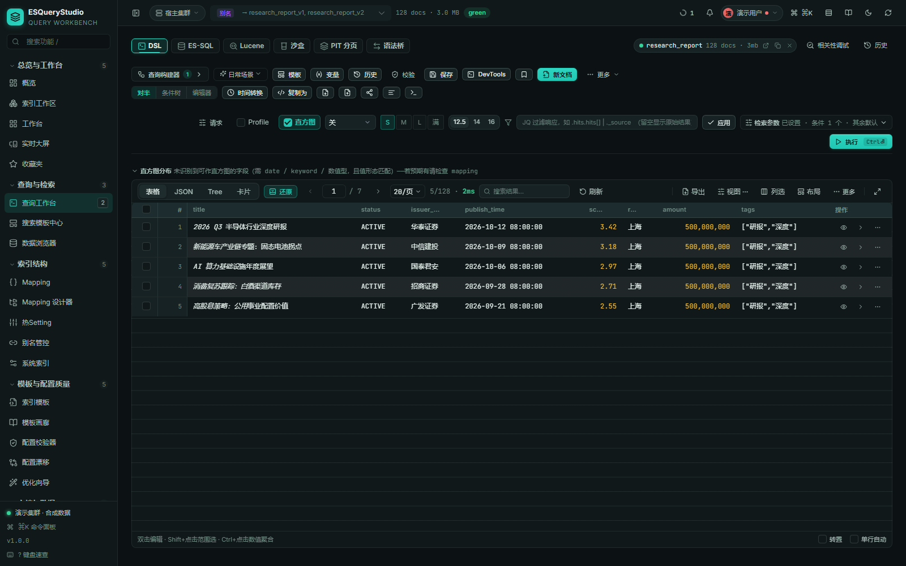

# 查询工作台

> ESQueryStudio 的核心不是「又一个 Elasticsearch 管理页」，而是一块把查询写成、跑通、解释清楚、
> 再定位慢点的连续工作台。本文说明它的六种模式、语义层、双向同步、结果面和相关性实验室。

## 设计目标

Elasticsearch 查询的日常摩擦通常不在「不知道 DSL 怎么写」，而在四处断点：

1. 写完 DSL 要去另一个页面执行，结果和请求体分开看；
2. 补全只认通用关键字，不知道当前索引有哪些字段、字段是什么类型；
3. 条件树和原始 JSON 各改各的，切换一次就有一边过期；
4. 查询能跑但结果不对，或者查询很慢，却没有一条从「哪条子句命中」到「时间花在哪」的路径。

ESQueryStudio 的查询工作台把四件事收进同一个现场：**请求体、条件树、结果、解释**。六种模式只是
同一个现场的六种入口，不是六个互不相干的工具页。

## 六种模式

| 模式 | 适合的输入 | 关键能力 | 结果面 |
|---|---|---|---|
| DSL 构建器 | 想可视化搭查询，或想在树和原文之间来回改 | 40+ 子句按字段类型出现；稀有子句有专门入口；未知子句回退原文；树⇄文本双向同步 | 表格 / JSON / Tree / 卡片；直方图；耗时与分片状态 |
| ES-SQL | 熟悉 SQL，想直接查 `_sql` | `_sql` 查询、`cursor` 深分页、字段体检、结果列展开、SQL ⇄ DSL | 表格 / JSON / Tree / 卡片 |
| Lucene | 已有 Lucene 语法或想快速验证 | Lucene 直查、原始高亮、命中行带去构建器精修 | 命中行 + 高亮 |
| 查询沙盒 | 想验证一个 DSL 假设 | 自由编辑、原始响应、`_source` / highlight 对比 | 原始响应 / 结构化视图 |
| PIT 深分页 | 需要稳定翻过 10k 窗口 | Point-in-Time、`search_after`、游标续拉与断裂解释 | 分批结果表 |
| 语法桥 | 想从 SQL 迁移到 DSL 或反向 | 双向翻译、语义差异提示、不可翻译片段保留原文 | 翻译结果 + 差异说明 |

> **SQL 数组字段默认严格**：`SELECT` 多值字段若不被 ES SQL 支持，会明确报错并给「开启宽容模式」入口；
> 宽容模式会把数组压成首值，结果区会持续标注这一口径。要保留数组语义，请改用 Lucene / PIT。
> SQL 结果列保持 raw 类型：数组显示为 JSON，`long`/`boolean` 不按值改写成时长或百分比。

### 模式之间的共享状态

- `?idx=` 与当前连接是六模式共享的；切模式不换索引、不丢现场。
- 历史、收藏、草稿、分享深链共用一套现场；查询结果和「上次工作现场」可以回放。
- 深链使用 base64 编码的 DSL，刷新/分享/从其他页面跳入都能恢复同一查询。
- 任务/场景生成 DSL 后强制切到 DSL 模式，但保留其他模式的 KeepAlive 实例，切回不重新初始化。

## 语义层：补全、lint、值枚举

查询工作台的补全不是静态关键字表，而是从当前索引的实时状态派生：

### mapping 感知

- 字段名、字段类型、`text` 的 `.keyword` 子字段、`object` / `nested` 层级都来自当前索引 mapping；
- 字段角色（标题、主体、时间、分类、数值等）参与候选排序，常用业务字段优先出现；
- 不可排序字段（`text` 未带 `keyword`、`object` 等）不会被推荐进 `sort`；
- 未知字段不会静默通过：lint 直接指出「字段不存在」并给出可用字段。

### analysis 感知

- `analyzer` / `search_analyzer` / `normalizer` / 同义词来自索引设置；
- 分词实验室、同义词字典和 Analysis 全景与查询工作台共享同一套 analysis 读取口；
- 字段值枚举从当前索引的真实取值拉取，而不是让用户手输一个可能不存在的值。

### 版本感知

- 每个模式、子句和页面契约都有 `minVer`；当前集群版本不足时在入口处显示 `需 x.y+`，而不是执行后才报错；
- 7.x 与 8.x 的差异（例如 PIT、SQL 能力、请求体形态）在提示层给出，不把版本问题伪装成语义错误。

### lint 的边界

lint 只做**静态可判定**的检查：结构、字段存在性、类型可排序性、日期格式、聚合/排序冲突、
`text` 字段的排序风险等。它不假装知道运行期数据分布；真正的裁决仍由 Elasticsearch 返回，
错误响应会保留全文、错误类型与可操作建议。

## 树 ⇄ 文本双向同步

这是工作台最容易被低估的部分。实现上不是「树改完拼一个字符串」，而是：

1. **解析**：把 DSL 解析成可编辑的条件树；已知子句进入结构化节点，未知子句保留为 raw 节点。
2. **编辑**：树上的每个字段、操作符、值位置都可改；结构化节点和 raw 节点可以共存。
3. **序列化**：树重新生成 DSL 时保留未知子句和原始顺序语义，不静默丢弃用户写的内容。
4. **回写**：编辑器内容变化后反向解析；无法结构化的部分留在原文，用户不会看到「树里没了但 JSON 里还在」的假象。
5. **守卫**：双向同步有源码锁与行为锚，覆盖空树、未知子句、嵌套 bool、数组/对象值等边界。

> 设计上宁可让一个稀有子句以 raw 形态存在，也不为了「树看起来完整」而丢掉它。

## 结果面

- **统一表格内核**：查询工作台、索引工作区、数据浏览器共用同一套表格能力（排序、列选择、密度、导出、行详情、右键/菜单键第二通道）。
- **JSON / Tree / 卡片视图**：同一结果多种读法，不重新发请求。
- **直方图**：按可识别的时间字段自动出桶；没有可用字段时明确说「未识别到可作直方图的字段」，不伪造空图。
- **耗时与分片**：`took`、`_shards`、`total` / `totalGte` 和「是否还有下一页」都在结果工具行可见。
- **导出**：CSV / Markdown / XLSX / NDJSON / JSON，导出格式与表格列选择同源。
- **诚实态**：请求失败时保留旧结果并标注「上次结果，不是本次」；取消不报成失败；权限拒绝给出可解释的页面级说明。

## 相关性实验室

查询工作台与相关性实验室共用查询现场，形成从「命中」到「为什么命中」的闭环：

| 页面 | 回答的问题 |
|---|---|
| 打分解剖 | 这条文档的 BM25 分数由哪些因子构成？ |
| 排名侦探 | 同一文档在不同查询下为什么排名变化？ |
| 查询 X 光 | 每条子句实际匹配了哪些词项、多少文档？ |
| 子句命中矩阵 | 哪条子句命中了哪些文档？哪条写了却没起作用？ |
| Boost 调参沙盒 | 改 boost 后排序怎么变？ |
| Profile 火焰图 | 时间花在 rewrite、build_scorer、next_doc 还是采集器？ |

每个页面都接受 `?idx=` 与查询现场，可以从结果行直接跳转，不需要重新复制 DSL。

## 性能与安全

- **生成守卫**：重复执行/连查时旧请求被作废，旧包不会覆盖新结果；取消与失败分开处理。
- **写入闸**：查询工作台中的保存、删除、批量写入等动作在函数体内做互斥，不只依赖按钮 `disabled`。
- **权限面**：页面级读/写键、连接级授权、控制面索引保护三层分离；前端隐藏不替代后端校验。
- **控制面保护**：系统索引/锁索引的 Raw 通道有专门守卫，不允许通过查询工作台绕过。
- **性能基线**：空闲页 0–18ms / 2.5s、无 longtask；工作台交互不引入常驻轮询，Monaco 按需加载。

## 代码入口

| 关注点 | 入口 |
|---|---|
| 查询工作台壳与六模式切换 | `ui/src/views/QueryHubView.vue` |
| DSL 构建器 / 原始编辑器 | `ui/src/views/DslQueryView.vue`、`ui/src/components/builder/` |
| DSL lint / 补全上下文 | `ui/src/utils/dslLint.ts`、`dslCompletionContext` |
| 表格内核 | `ui/src/components/ResultTable.vue`、`QueryResultTable.vue` |
| 相关性实验室 | `ui/src/views/ScoreExplainView.vue`、`RankDebugView.vue`、`QueryXrayView.vue`、`ProfileFlameView.vue` |
| 页面契约 | `platform/src/main/resources/META-INF/esquerystudio-pages.json` |

## 验证方式

- 源码锁：六模式、契约、补全源、lint 规则、双向同步边界都有 spec。
- 行为锚：真实浏览器中执行查询、切模式、刷新、翻页、取消、权限拒绝、错误回包。
- 反向对照：非法 DSL、未知字段、不可排序字段、坏日期格式必须先红后绿。
- 真实截图：本页图片来自真实控制台（Mock ES 数据），不使用伪造演示状态。
